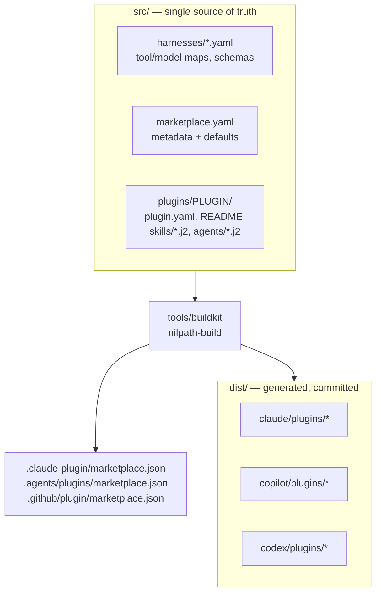

# nilpath-marketplace

Tri-client marketplace: **5 plugins** (15 agents, 66 skills) authored once under `src/` and built into per-harness trees under `dist/` for **Claude Code**, **GitHub Copilot CLI**, and **Codex**. Native Copilot use inside VS Code is unsupported. Running Copilot CLI in a VS Code terminal remains CLI usage.

## Critical rule: src/ is the only editable source

**`dist/` is release-owned.** It and the three root registries (`.claude-plugin/marketplace.json`, `.agents/plugins/marketplace.json`, `.github/plugin/marketplace.json`) are generated by buildkit from `src/`. Ordinary PRs cannot add, edit, delete, rename, or change modes in those paths.

To change anything that ships:

1. Edit the matching source under `src/` (usually `src/plugins/<plugin>/`, or `src/harnesses/` / `src/marketplace.yaml`).
2. Run `make test-static`. Tests render current sources into a temporary tree without changing committed installation files.
3. Commit sources only. Release preparation owns version bumps and generated updates.

```bash
make check        # validate sources
make test-static  # test fresh temporary output
```

## Structure



## Plugins

| Plugin | Skills | Agents |
| --- | --- | --- |
| git-tools | git-commits, git-advanced, git-stacked-prs, using-git-worktrees, gh-pr-review, gh-address-comments | — |
| engineering-workflow | researching, planning, executing-plan, performing-code-review, engineering-principles | task-decomposer; spec/plan/code reviewers; api/architecture/docs researchers; code-debugger; coding/python task agents |
| documentation | writing-documentation, creating-mermaid-diagrams | doc-writer, doc-auditor |
| authoring-tools | creating-agents, creating-skills | — |
| nstack | nstack-flow, setup-nstack, nstack-help, how, why, architect, candidate-graft, swarm, review-panel; 28 principle-* skills; unslop, technical-writing, no-comments, deslop, control-cli, control-ui, benchmark-checklist, tdd, show-me-your-work, figure-it-out, typescript-best-practices, python-best-practices, create-verification-skill, maintain-verification-skill | nstack-agent, nstack-reader, comment-sicko |

Cross-plugin references are plugin-qualified (e.g. `Skill(git-tools:git-commits)`, `documentation:implementation:doc-writer`). engineering-workflow depends on git-tools and documentation. nstack is independent; its skills reference each other by relative path, and a plugin hook (`src/plugins/nstack/hooks/`) applies per-role models. A plugin's `hooks/hooks.json.j2` renders per harness to that harness's `hooks_path`; other files in `hooks/` ship next to it.

## Authoring conventions

Sources use the **canonical vocabulary** from `src/harnesses/tools.yaml`, never harness-specific names:

| Axis | Canonical values | Rendered per harness via |
| --- | --- | --- |
| tools | `shell(git:*)`, `file-read`, `file-write`, `file-edit`, `glob-search`, `content-search`, `web-fetch`, `web-search`, `subagent(x)`, `skill(x)`, `ask-user`, `todo` | `tools.map` in `src/harnesses/<h>.yaml` |
| model | `small`, `medium`, `large`, `xlarge` (ordered, extensible) | `models.map` |
| reasoning | `minimal`, `low`, `medium`, `high`, `max` | `reasoning.key` + `reasoning.map` |

- Frontmatter must declare `targets:` (`[claude]` or `[claude, copilot, codex]`).
- Harness passthrough for names outside the vocabulary: `claude:mcp__server__tool`.
- Harness-specific content uses `…`; script paths use `{{ skill_root }}`.
- Templating is opt-in per file via the `.j2` suffix; other files copy verbatim.

Agent `tools` describe availability. Skill `tools` describe approvals. A complete
`frontmatter.skill.tools` harness policy overrides the top-level agent/default
policy without merging. Copilot skill approval emission stays gated. Never turn
on `key_for_tools` without permission-enforced runtime evidence, and never map
unscoped source shell to a newly enabled blanket approval. See
[skill permissions](ai_docs/skill-permissions.md).

**Prose helpers** (from `prose:` in `src/harnesses/<h>.yaml`) render orchestration phrasing in each harness's native mechanism — use these instead of writing `Agent(...)`/`TodoWrite`/`AskUserQuestion` literally:

| Helper | Claude render | Copilot/Codex render |
| --- | --- | --- |
| `{{ spawn('plugin:cat:agent') }}` | `` `Agent(subagent_type="…")` `` | "the `agent` custom agent…" / "the `agent` agent (spawn it as a subagent)" |
| `{{ launch('plugin:cat:agent', '[tag]') }}` | "`` `Agent(subagent_type="…")` `` with `[tag]` at the start of `description`…" | "the task tool with agent type `plugin:agent`, `[tag]` at the start of the description…" / "`spawn_agent` … `message` that starts with `[tag]`…" |
| `{{ skill_ref('plugin:skill') }}` | "the `plugin:skill` skill" | "the `skill` skill (`/skill`)" / "the `skill` skill" |
| `{{ todo }}` | "the `TodoWrite` tool" | "the todo list" / "the plan tool (`update_plan`)" |
| `{{ ask_user }}` | "the `AskUserQuestion` tool" | "a direct chat question to the user (…)" |

A plugin with zero components for a harness is skipped entirely in that harness's `dist/` tree and registry (e.g. authoring-tools exists only under `dist/claude/`).

## Common Tasks

### Add a skill

1. `~/.virtualenvs/nilpath-marketplace/bin/nilpath-build new-skill <name> --plugin <plugin>`
2. Author `src/plugins/<plugin>/skills/<name>/SKILL.md.j2` with canonical frontmatter
3. Run `make test-static`. Leave versions and generated output to release preparation.

### Add an agent

1. Create `src/plugins/<plugin>/agents/<category>/<name>.md.j2` (categories: review, research, implementation, planning)
2. Run `make test-static`. Leave versions and generated output to release preparation.

### Release changes

See [ai_docs/release-workflow.md](ai_docs/release-workflow.md).
Ordinary changes do not manually bump versions. After merging a plugin's changes,
run `make release PLUGIN=<plugin> BUMP=<major|minor|patch>`. The command creates a
version-bump commit and opens a draft PR without changing your current checkout.
The Release workflow prepares that plugin's notes and generated output in the PR.
After human review and squash merge, it tags the merge commit and creates a draft
GitHub release. Publishing remains manual.

## Version Sync

The build propagates versions from **`src/plugins/<plugin>/plugin.yaml`** and
`src/marketplace.yaml` into every generated manifest. Source YAML is the current
version authority. `.release/baselines.toml` records historical commit provenance,
not duplicate mutable versions. Each release updates one plugin:

| File | Update |
| --- | --- |
| `src/plugins/<plugin>/plugin.yaml` | Explicit major, minor, or patch bump |
| `CHANGELOG.md` (repo root) | Document changes |
| root `README.md` + existing source README current-version headers | Exact current-version fields only, never historical references |
| generated files and registries | selected plugin only, rendered by buildkit |

Preparation renders into a temporary directory, then promotes only the selected
plugin's output and registry entries. Other installed plugins and marketplace
metadata remain unchanged, even when their sources have pending changes.

### Release boundaries

- The caller chooses the version increment. There is no automatic bump planner,
  decision file, or release-plan check.
- Ordinary CI validates the PR title, runs the standalone generated-file guard,
  and runs tests against fresh temporary output.
- A release PR contains one source-version bump and its exact derived files.
  Only a validated release PR may change generated paths.
- Privileged preparation uses protected-main code. It reads the candidate as Git
  data and never runs candidate tools, dependencies, or templates.
- Require `pr-title`, `test-static`, an up-to-date branch, human approval of the
  latest push, and squash merging. Review the prepared output before merging.
- Tags use `<plugin>/v<version>` and point to the PR's merge commit, never a later
  main tip. Conflicting tags fail instead of moving.
- Marketplace-metadata releases, initial releases without a historical anchor,
  multi-plugin batches, and automatic publication are outside this command.

## Deep Dives

| Topic | Link |
| --- | --- |
| Skill structure, YAML spec, patterns | [ai_docs/skill-architecture.md](ai_docs/skill-architecture.md) |
| Agent design, tools, delegation | [ai_docs/agent-architecture.md](ai_docs/agent-architecture.md) |
| Release process, version sync | [ai_docs/release-workflow.md](ai_docs/release-workflow.md) |
