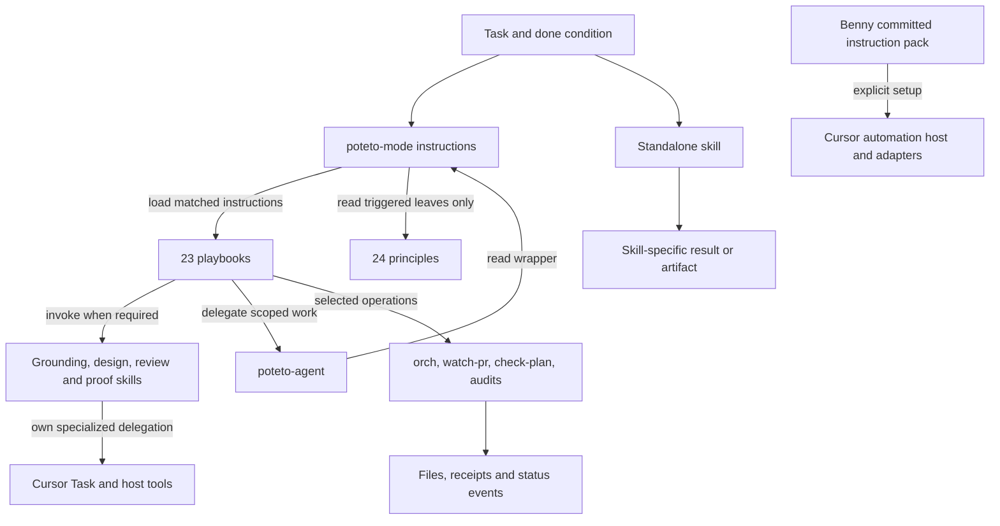
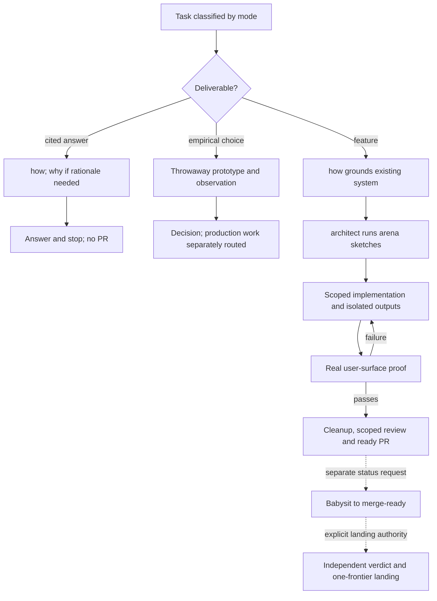
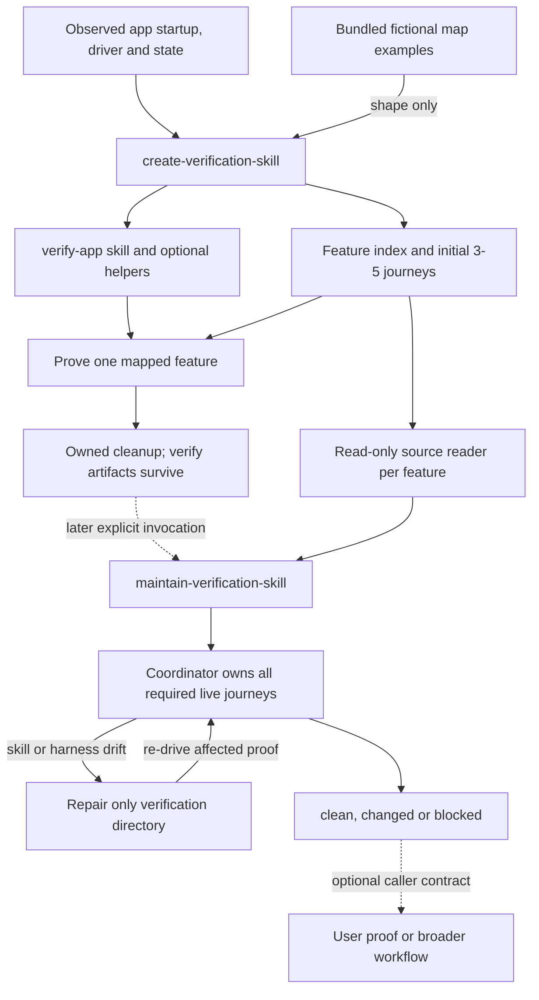
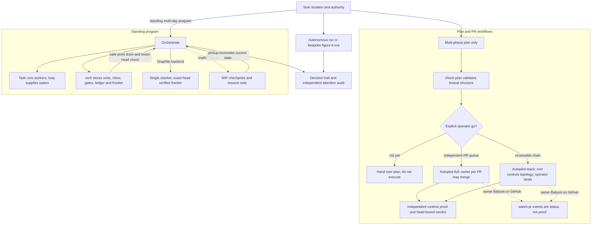
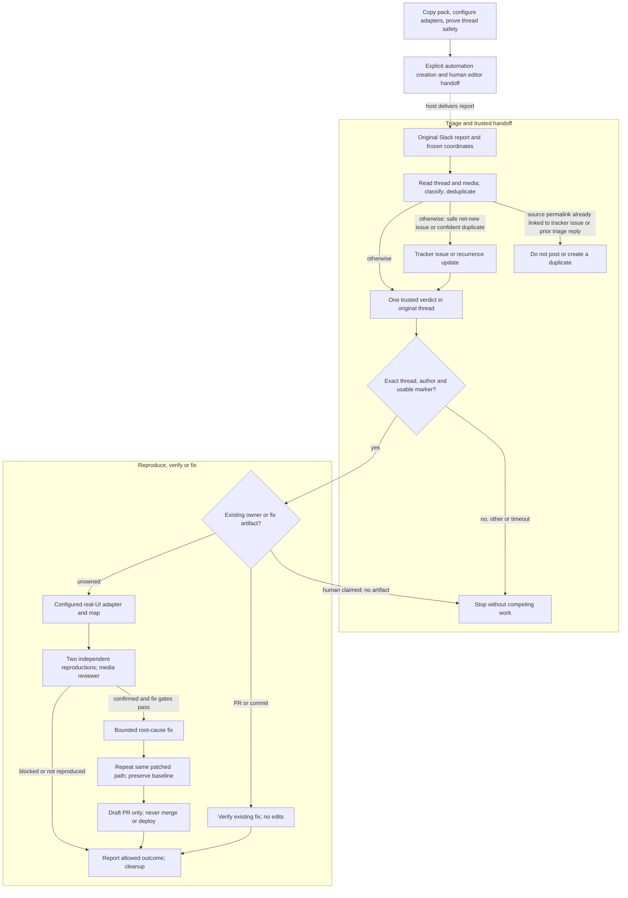

# pstack architecture and dependency analysis

## Context & Problem

**pstack is Lauren Tan's (poteto's) collection of engineering instructions for Cursor agents, backed by a small set of executable helpers.** Its main entry point, `poteto-mode`, interprets a task, selects a playbook, brings in relevant principles and specialist skills, delegates work, and requires evidence before declaring success. It is not a server, an agent runtime, or one executable pipeline. Its stated aim is less, better-grounded code rather than more generated code. [Upstream introduction][readme], [router][mode].

A typical feature task moves from understanding the existing system (`how`) to comparing designs (`architect` using `arena`), implementation, real-surface proof, cleanup and a PR. A question can instead end after investigation. A prototype ends with a decision, not production code. PR monitoring and landing are separate requests with different authority. These connections matter because extracting a router or playbook without its prompts, evidence contracts and host capabilities changes its behavior. [Feature][pb-feature], [Investigation][pb-investigation], [Prototype][pb-prototype], [Opening a PR][pb-opening-a-pr], [Shipping][pb-shipping].

**Standalone verification does not require importing all of pstack.** `create-verification-skill` writes and proves an app-specific `verify-*` skill and feature map. `maintain-verification-skill` consumes that directory and its launch/drive/evidence/cleanup contract. Neither directly invokes `poteto-mode`, `architect`, `arena`, `swarm`, the model rule, team-kit, Benny, `orch`, or `watch-pr`. A *caller* may impose additional requirements; those are not retroactive dependencies of the generator. This distinction is central to the comparison with the unmerged verification pair in PR #38. [Generator, L9–44][create-verification-skill], [maintainer, L9–39][maintain-verification-skill].

This document describes the observed upstream architecture and the information needed for a later **Copilot CLI-first** product decision. It does not choose v1 features, name a plugin, propose its implementation, or recommend moving existing skills.

### Reading guide

| Need | Read |
|---|---|
| Understand the system first | [Component overview](#component-overview), [data flow](#data-flow) |
| Separate promises from enforcement | [Helpers](#executable-helpers), [source contradictions](#source-contradictions-and-gaps) |
| Understand generated verification and Benny | [Verification lifecycle](#verification-lifecycle), [Benny](#benny-automation) |
| Assess the target client | [Copilot CLI portability](#copilot-cli-portability), [marketplace and PR #38](#relationship-to-this-marketplace-and-pr-38) |
| Find every component or relationship | [Inventory](#complete-component-inventory), [dependency tables](#authoritative-dependency-map), [coverage](#source-index-and-coverage) |
| Frame a later decision without making it | [Dependency clusters and unanswered v1 decisions](#dependency-clusters-and-unanswered-v1-decisions) |

## Source baseline, scope and method

| Subject | Inspected baseline |
|---|---|
| Upstream | [`cursor/plugins`, `pstack/`][upstream] at **`dbf49813a39c1a5389c5e28cb8e4c1c2379e2454`**, manifest version **0.15.23** |
| Attribution | Lauren Tan / poteto; copyright 2026, [MIT license][license]. This is original, attributed analysis, not a reproduction of the upstream guide. Copies or substantial source adaptations must preserve the license notice. |
| Upstream coverage | All **168 files** accounted for: **161 text files** read in the source study and **7 image assets** inventoried without decoding. **53 top-level skills**, including **24 principles**; **23 playbooks**, **2 agents**, **3 dormant Benny skills**. |
| External source boundary | Actual `deslop`, `control-cli`, and `control-ui` instructions in `cursor-team-kit` at the **same SHA**. Cursor built-ins and live service implementations are outside the snapshot. |
| Local marketplace | `feat/authoring-tools-portability`, **`240cd7c848308a5faedaf703ae4476cfe386315f`**, the unmerged PR #39 baseline, **not `main`**. Local links describe that checkout. |
| Verification PR | [PR #38][pr38], **OPEN/unmerged when inspected**, head **`65a0f1368efaabc844e5e95e6c68ae5411872168`**, base `main`. Its source attribution points to older upstream **`1b6d44ff26d4e242f4e8f68c391e6d2f7ca16def`**. The pair is not present in this checkout. |
| Client evidence | Official Copilot CLI and VS Code documentation inspected on **2026-10-13**; local **Copilot CLI 1.0.95 version/help/commands only**. No plugin discovery, model dispatch or end-to-end compatibility test was performed. |

The research snapshot was hash-verified against the pinned Git objects. The study reconciled every path, recorded **193 typed/conditional dependency edges** and checked **439 line citations** for file existence and line bounds. Those checks establish traceability, not runtime correctness. This document uses that source study, direct reads of critical entry points and helpers, pinned PR sources, current repository templates and official client documentation.

In the text, **source fact** means an instruction or implemented behavior at the pinned revision; **documented capability** means a client documentation claim; **inference** means an architectural consequence, not a wired integration. An **unknown** remains untested. No upstream scripts, tests, installations, automations, model calls, personal transcripts, credentials, chat channels, trackers or production systems were exercised for this analysis.

## Component Overview

The [root manifest][manifest] declares Agent Plugins 1.0 metadata. The [Cursor manifest][cursor-manifest] advertises `./skills/` and `./agents/`. Neither defines an executable router, scheduling service, hooks, external dependency installer or MCP server configuration. Benny lives outside the advertised roots and is deliberately dormant. [Benny README, L1–23][benny-readme].

This diagram shows categories, not an all-to-all call graph. The [dependency tables](#authoritative-dependency-map) are authoritative about direction and conditions. In particular, the `poteto-agent → poteto-mode` edge is **instruction loading**, not a recursively spawned router.

### Layers and responsibilities

| Layer | Role | Boundary |
|---|---|---|
| Entry and navigation | `setup-pstack`, `poteto-help`, `poteto-mode`; individually invoked skills | Setup configures models; help reads the appropriate source; mode routes actual work. |
| Engineering policy | 24 principles, prose and TypeScript guidance | Select relevant leaves; do not assume all principles are loaded or mechanically enforced. |
| Specialist workflows | `how`, `why`, `architect`, `arena`, `swarm`, `interrogate`, verification and history skills | Different delegation, permissions, synthesis and evidence contracts; not interchangeable “parallel agents.” |
| Playbooks | Task-specific sequences and terminals | Some produce code/PRs, some only a plan, diagnosis, prototype, checkpoint or cleanup report. |
| Agent definitions | `poteto-agent`, `comment-sicko` | Wrapper for scoped work versus a **comment-editing** specialist. |
| Helpers | Bun/Node/Bash programs | Enforce selected file, queue, shape and status rules. They do not establish the truth of evidence or run the agent organization. |
| Host/integrations | Cursor Task, Custom Modes, `/loop`, automation editor, app drivers, forges, MCP | Lifecycle, persistence, permissions, authentication and real app access are supplied elsewhere. |
| Dormant automation | Benny bootstrap, triage and reproduction/fixing | A copied, committed, configured pack with source-thread authority and draft-only delivery, not three installed slash skills. |

Sources: [mode, L13–147][mode], [agents][agents-tree], [tools package][tools-package], [Benny bootstrap][benny-bootstrap].

## Data Flow

### Setup, routing and an ordinary task

`setup-pstack` detects available `Task` model slugs (or asks when detection is unavailable), collects budget and role choices, validates the choices, and rewrites `~/.cursor/rules/pstack-models.mdc` with `alwaysApply: true`. It applies to new sessions. Missing role lines retain in-skill defaults. It offers verification generation only when the project lacks a harness and the human accepts. [Setup, L8–74][setup-pstack].

Mode then owns the todo list. It loads the matched playbook completely, copies its steps verbatim, and keeps skipped steps with reasons. Large/cross-cutting or review-later work can route to `figure-it-out`; a standing multi-day program routes to Orchestrate. Neither is a universal prerequisite. [Mode, L119–147][mode].

The feature branch is illustrative. Bug fix first reproduces the same user-visible symptom, uses `how` and regression history through `why`, eliminates hypotheses and fixes the runtime cause. TDD is conditional on an inexpensive existing test path. Refactoring first pins current behavior. Perf issue requires a credible baseline and post-fix trace; Hillclimb freezes a proven-sensitive harness and records accepted/reverted attempts. [Bug fix][pb-bug-fix], [Refactoring][pb-refactoring], [Perf issue][pb-perf-issue], [Hillclimb][pb-hillclimb].

`architect` derives interfaces from caller usage, obtains at least two structurally distinct candidate sketches through `arena`, screens red flags and synthesizes a rationale. Without an explicitly requested checkpoint it can proceed into implementation; repeated friction sends it back to design. `arena` chooses and grafts artifacts. `swarm` covers slices or races with an explicit completion/selection rule. `interrogate` independently reviews the same intent and returns a lead's findings without auto-applying them. [Architect, L23–79][architect], [Arena, L9–48][arena], [Swarm, L9–46][swarm], [Interrogate, L9–74][interrogate].

Cleanup is not one operation. `no-comments` delegates comment deletion, audits the actual diff/report, and may fix accepted root-cause flags within the caller's scope. Its architectural escalation stops at a sketch. Encoding a constraint needs approval or caller preapproval. `deslop` is a separate external diff-cleanup skill. `technical-writing` and then `unslop` shape publication prose. [No comments, L19–24][no-comments], [Comment Sicko, L26–32][comment-sicko], [Opening a PR, L9–34][pb-opening-a-pr].

Opening a PR does **not** start monitoring. Babysit distinguishes `check`, `threads-only`, `background` and `drive`, and does not itself acquire permission to merge. Shipping independently proves each PR against its parent, records verdict identity, and lands only the contiguous passing run from the bottom. Green CI, bot approval, or watcher `READY` is not that proof. [Babysit][pb-babysit], [Shipping][pb-shipping].

### Verification lifecycle

The generator interviews the repository for the primary surface, startup, drivers, observable results and isolation. Browser/CDP, PTY/tmux and HTTP are alternatives chosen for the target, not a cumulative platform dependency. A library or service is a legitimate target; real UI is not universally required. Existing harnesses take precedence. A broken startup prerequisite must be fixed within scope or reported rather than turned into fictional instructions. [Generator, L11–21][create-verification-skill].

The generated `.cursor/skills/verify-<app>/SKILL.md` has `name` and `description` frontmatter and these sections:

| Section | Contract |
|---|---|
| Launch | Exact startup and usable readiness from empty data, including migrations/seed. Servers can persist; short-lived CLI/TUI drives use fresh isolated sessions after a one-time build. |
| Doctor | Read-only check of process, expected version/build, owned port and auth. Port responsiveness alone is insufficient. |
| Drive | Actual commands/selectors/routes, favoring stable handles. |
| Evidence | Real action **and** resulting state, plus external side effects. Mocks only at existing production boundaries; observe what dry-run actually skips. |
| Cleanup | Stop only owned instances and remove owned scratch. Keep proof at the named durable location and check it still exists. |
| Helpers | If supplied, scripts are executable and their invocations are documented in the skill. |

`features/README.md` indexes one file per user-facing feature, initially the top 3–5. Each has `Sub-features`, `How to get to it (user POV)`, `Driving it with <harness>`, and `Gotchas`. Missing fixture prerequisites remain an explained failure, not a weakened journey. The Notes examples are fictional shape examples, not installed app dependencies. Initial generation proves **one** mapped feature; it is not a claim of complete-map coverage. Stand-in environment differences remain unverified. [Generator, L23–44][create-verification-skill], [map examples][verification-examples].

Maintenance locates an existing compatible target (several means ask; none means stop and point to creation), repairs index hygiene, and gives every feature a read-only source reader. Each returns a summary, cited entry points, drift or none, and a live recipe. The coordinator reconciles overlap and newly uncovered surfaces and performs the live pass even when all source looks clean. Children do not drive or edit. The target's Launch section determines persistent versus per-drive sessions. [Maintainer, L25–39][maintain-verification-skill].

Doctor runs before driving, for fresh sessions and after failed/surprising drives. A healthy but wedged UI needs reset/relaunch. Skill-caused doctor drift gets a scoped repair and one retry, restarting only invalidated work. Evidence survives every cleanup; failed-attempt residue is removed without stopping another owner's shared instance. Every harness correction is re-driven. `verified-unreachable` needs the concrete prerequisite and attempted route, not an invented success. Product regressions are reported, never hidden in the map or fixed in this maintenance PR.

The outcomes are `clean` (coverage complete, nothing to ship, no PR), `changed` (one proven corrections PR), or `blocked` (coverage or safe shipping incomplete). The guide's optional feature-map `swarm` pass and daily automation advice are not the maintainer's own serialized-driving policy or a bundled scheduler. A generated verifier can supply app-specific proof to another workflow, but does not automatically satisfy that workflow's independent-review or shipping gates. Benny has a different map and real-UI adapter contract. [Guide, L53–95][guide-verification], [Benny control contract][benny-control].

### Long-running work, delivery and recovery

These paths differ in scope and ownership:

* **Autonomous run** keeps the original falsifiable predicate, uses event/heartbeat wakes from `/loop`, and records verified keep/revert iterations. A plateau is not completion; a genuine dead end is reportable. **figure-it-out** quantifies work/risk and authors a bespoke phase list; it invokes design competition only for unsettled one-way-door decisions. [Autonomous run][pb-autonomous-run], [Figure it out][figure-it-out].
* **Multi-phase plan** produces, but does not execute, a plan under the agent store's `docs/` by default. It resolves empirical forks with prototypes, specifies PR dependencies and named execution policy, unit/live/perf/review/merge blocks, ten live lanes and a trunk regression lane. `check-plan` validates textual structure; explicit go remains a separate gate. An obvious 1–2-file task skips the oversized plan. [Plan, L1–155][pb-multi-phase-plan].
* **Autopilot-full** assigns one lifecycle owner per independent PR. Owners publish a ready PR early, push verifiable units and report code-ready head SHAs. Root runs independent verification rounds while owners perform self-proof/CI/Babysit. Patch-changing pushes require a new round. Root audits liveness hourly, including child receipts; owners merge only after valid current-head proof and gates. Roles outlive individual agents. **Autopilot-stack** inherits the proof/owner contract but root alone rebases/retargets the linear chain; owners cannot merge, auto-merge or close it. [Full][pb-autopilot-full], [Stack][pb-autopilot-stack].
* **Orchestrate** collapses session-sized work before creating a program store. Otherwise it frames countable units/budgets, writes standing orders, pilots the full lifecycle, then runs bounded waves. Completion notifications enter an inbox; coordinators drain at named safe points instead of interrupting a unit. Brief audits and verifier work accompany the wave. Workers do not own `gt`/rebase operations; one stacker owns each stack. **Task runs agents; `orch` does not.** [Orchestrate, L13–92][pb-orchestrate].
* **Shipping** tracks head SHA, base SHA and stable patch-id with the verdict. A rebase/retarget demands rechecking identity, CI and mergeability. An unchanged patch can retain the code verdict. Its narrow changed-test/docs/lint build-reuse exception needs two old builds and one new build to establish noise/embedded-SHA differences; absent build output, rerun the lane. Landing is one frontier PR at a time with actual merged-state confirmation. [Shipping, L7–15][pb-shipping].
* **Recovery** records failed/zombie units; Orchestrate retries twice then abandons/replans. Restart re-reads stores, recomputes frontier, reattaches cloud work by branch/PR and respawns local coordinators. Pause safely is explicit suspension, not a grant to continue: settle the current atomic unit, cancel children, create WIP plus a durable resume note. Session pickup reconciles prior claims against actual artifacts. Worktree cleanup is a separate advisory audit with active/pinned use and ownership checks before deletion. [Orchestrate, L93–111][pb-orchestrate], [Pause][pb-pause-safely], [Pickup][pb-session-pickup], [Cleanup][pb-worktree-cleanup].

Cloud workers cannot read a local agent store. Briefs must inline required findings/standing orders or point to committed repository files. Local delegates can use file pointers. The mode's “fresh agents” policy requires consolidated scope on new rounds; only expensive state such as a live server or uncommitted checkout justifies same-agent continuation. [Mode, L91–101][mode], [Orchestrate, L13–65][pb-orchestrate].

### Benny automation

Benny is a **dormant deployment pack** under `automations/benny/`, not an enabled service. Setup merges the whole pack into a target repository's `.cursor/automations/benny/`, preserves conflicting/destination-owned edits, enables project-scope pstack in `.cursor/settings.json`, and keeps user config/maps outside the copied pack. Fresh automation checkouts need committed same-repository paths, not the current agent's loaded skills or plugin-cache paths. [Bootstrap, L53–89][benny-bootstrap], [Setup, L48–113][benny-setup].

Setup requires project availability of `how`, `why`, `tdd`, `unslop` and six principles: separate-before-serializing-shared-state, minimize-reader-load, guard-the-context-window, sequence-verifiable-units, fix-root-causes and prove-it-works. This is an installation requirement; runtime `why` and `tdd` calls remain conditional. Setup invokes Cursor's built-in `automate` only on explicit first-time creation, completing one draft/approval/readiness/editor handoff before the other. Existing automation updates are a manual editor checklist. Thread-safety checks precede normal traffic. [Setup, L48–71, L168–266][benny-setup].

The secret-free example config defines `automations`, `slack`, `repository`, `tracker`, `routing`, `control`, `verdict_markers`, `status_emoji`, `budgets` and `models`. Slack source/operations channel, trusted triage identity and action names are explicit. Tracker operations include compensation. `control.skill_name` and `control.feature_map_path` name user-supplied resources. `schema_version: 1` and timing defaults are **example configuration interpreted by prompts**, not a bundled validator or scheduler. Example budgets are 45-second polling, 45-minute verdict wait, 10-minute triage follow-up, 30-minute triage total, 60-minute repro, 10-minute rejection window, 90-minute fix and 45-minute operations follow-up. Artifact retention is 24 hours in the example. [Configuration][benny-config].

Triage freezes source channel/root/permalink, reads attachments, traces causes with `how` and conditional `why`, and uses an optional evidence-based routing map. Missing repo access permits conservative classification, not invented ownership. First check whether the source permalink is already linked to a tracker issue or a prior triage reply; if so, do not post or create a duplicate. Otherwise, confirmed duplicates update recurrence; possible live duplicates do not create a new issue. Before creating a clear net-new bug/performance issue, required tracker and Slack capabilities must be available, including compensation if the new issue's handoff fails. For reports not suppressed by that duplicate check, one final trusted marker is posted and read back in the original source thread. Invalid parent coordinates mean no writes; there is no source-root fallback. [Triage, L11–42, L71–168, L196–240][benny-triage].

Reproduction accepts only a configured identity's marker in that exact original thread. Other, missing, conflicting or timed-out verdicts stop. A human claim without a concrete artifact stops competing work; a plausible PR/commit routes to verification of the existing fix without edits. An operations-channel root is separately permitted when configured; otherwise operational status stays in run output. [Repro, L36–121][benny-repro], [existing-fix branch][benny-existing].

The control adapter must implement **bring up, drive UI, drive mapped features/states, inspect state, screenshot, recording and cleanup**. It distinguishes the real target from similar windows/production instances, drives actual user actions, resets for independent attempts and returns evidence identity. Safe fixtures can arrange prerequisites but may not inject the symptom. All seven capabilities and a completed richer feature map are required, or repro/fix fails closed. Environment translation is labeled, and cannot substitute for an exact repro when the unavailable environment causes the defect. [Control contract, L1–169][benny-control], [feature-map example][benny-map].

The discriminating broken final state must reproduce **twice**, with recording, screenshot and a read-only cross-check; an independent media reviewer confirms that the symptom is actually visible. Only confirmed repro, absence of an owner/artifact, elapsed rejection window, understood cause and available budget permit a bounded fix. Children cannot receive Slack write tools/credentials; if that cannot be arranged, the coordinator owns the edits. The same patched user path is proven twice before a **draft-only** PR; no merge or deploy follows. Cleanup always runs and retains captures only within configured retention. These are prompt and adapter contracts, not proof that the host enforces them. [Repro, L123–310][benny-repro].

## Dependencies, state and operational assumptions

### Model roles and host capabilities

| Contract | Observed upstream behavior |
|---|---|
| Default families | Code defaults to `grok-4.7-xhigh-fast`; prose/judgment and hardest work to `claude-opus-5-5-xhigh`. These are source defaults, not a claim of current entitlement. |
| Role consumers | Mode's feature/refactoring, bug-fix, perf-issue, hillclimb, judgment/prose and hardest-task delegates; `how` explorer/explainer; `why` investigators/synthesizer; `reflect` tooling/judgment/divergent/synthesizer; `arena` runners/cross-judge pool; `swarm` workers; `architect` runners; `interrogate` reviewers. |
| Budget | `unlimited → max`, `large → xhigh`, `medium → high`, `small → medium`; select detected same-family effort at/below the budget when the exact slug is absent. Effort token can precede `fast`. |
| Inheritance | `auto` and `inherit-parent` mean **omit `Task.model`**, including individual panel seats. Missing role lines retain in-skill defaults. Not every skill reads the rule. |
| Rejected models | `how`/`why`/`reflect`/`swarm` report fallback through defaults and available same-family slugs. Panel workflows first fall back within family, otherwise Opus; `interrogate` also asks for a separate defaults-repair PR. |
| Task host | `subagent_type`, `model`, `readonly`, `run_in_background`, `environment: cloud/local`, `cloud_base_branch`. Availability and semantics are Cursor-host assumptions, not implemented in the plugin. |
| Read versus write | `how`/`interrogate` use readonly children. `why`/`reflect` use `readonly: false` for MCP access while their prompts forbid writes. Comment Sicko deliberately edits comments. |
| Other host functions | Custom Mode persistence, `/loop` wakes, AskQuestion, built-in authoring, PR tracking and automation editor lifecycle. `make-bot-ui` additionally expects routine/secret-request tools. |

Sources: [Setup, L10–69][setup-pstack], [mode, L91–101][mode], [How][how], [Why][why], [Reflect][reflect], [Arena][arena], [Interrogate][interrogate], [Swarm][swarm], [bot UI][make-bot-ui].

### External dependencies: capabilities, not one mandatory vendor stack

| Dependency | Consumers and condition | Absence or portability consequence |
|---|---|---|
| [`cursor-team-kit:deslop`][ext-deslop] | Mode and PR delivery cleanup before commit | External instructions, not bundled code. The [build guide][guide-build] permits equivalent plain-language cleanup when absent; the mode itself names the skill. |
| [`control-cli`][ext-control-cli] | CLI/TUI proof and repro | Reuse native harness, else tmux/PTY; Python/Node/Expect are possible alternatives. Transcript/profile/recording tools depend on target. Missing tmux can lead to a PTY probe. |
| [`control-ui`][ext-control-ui] | Web/browser/Electron proof | Prefer existing Playwright/Cypress/Storybook/Electron tooling or available browser/CDP tools. Do not add Playwright solely for a probe unless asked. No matching page means inspect candidates, not guess. Native/mobile needs its own driver. |
| Cursor `create-skill` | Agent-facing authoring, Authoring a skill, `automate-me`, approved substantive `reflect` edits | Built-in implementation is external; no general fallback is specified. Standalone verification generation does **not** directly require it. |
| Git / `gh` / optional Origin | History, worktrees, PR operations, patch identity | Delivery generally defaults to `gh` and optionally uses a resolvable Origin CLI; built-in PR tool wins where supplied. Auth, remote/base and operation permission are separate needs. |
| Graphite `gt` | **Orchestrate frontier only** | `orch` uses actual Graphite metadata and fails without it; there is no `gh` fallback in that helper. Do not generalize newer delivery playbooks' “no gt” policy to Orchestrate. |
| `why` evidence services | Git/PR anchor always; six additional categories when available/relevant; investigator fan-out by default, subject to E033's rare inline exception | Issue tracker (Linear example), long-form docs (Notion), team chat (Slack), observability (Datadog), errors (Sentry), warehouse (Databricks). Discover schemas and record unavailable/irrelevant categories. The examples are not a required six-vendor subscription. |
| Benny integrations | Slack reads/thread replies/media, tracker operations/compensation, safe test app, draft-PR action | Required writes fail closed when capabilities are missing. Optional `BENNY_SLACK_BOT_TOKEN` is a narrow configured fallback, never child access. No operations channel means no invented root fallback. |
| Visual tools | `teach` diagrams/spatial images; `ketchup` Mermaid, `/visualize`, optional images | `/visualize` provider is not identified or bundled. Diagram/image availability is conditional, not proof of integration. |
| Bot host and Tailscale | `make-bot-ui` | `update_state` routine creation, `SendToUser` secret handoff, connector credential file, Cursor webhook and local server. Tailscale install/login is prescribed if missing. No generic replacement for proprietary bot tools is supplied. |

Source detail: [Why source playbooks][why-sources], [Opening a PR, L23–29][pb-opening-a-pr], [Orch store, L1066–1166][orch-store], [Benny setup][benny-setup], [bot UI, L13–115][make-bot-ui]. MCP category research preserves direct/supported/inferred/speculative/unknown evidence; a missing service is a coverage gap, not a reason to invent rationale. Sentry Seer output is a hypothesis, and Databricks examples require discovered schema and read-only SQL, not assumed table names. [Why epistemics][why-epistemics], [source examples][why-source-tree].

### State and producer/consumer contracts

| Artifact / location | Producer → consumer | Invariant or limit |
|---|---|---|
| `~/.cursor/rules/pstack-models.mdc` | Setup → named model-selecting workflows | Validated role labels and detected slugs; new sessions; not every skill reads it. [Setup][setup-pstack] |
| `.cursor/skills/verify-<app>/` | Generator → maintainer and explicit app-proof callers | Skill, `features/README.md`, feature files, optional owned helpers. Maintenance edits only this directory. [Generator][create-verification-skill] |
| Named verification artifact location | Generated driver → human/maintenance/caller | Evidence survives every cleanup and reproof. Stand-in target gaps remain visible. [Maintainer][maintain-verification-skill] |
| `decisions.tsv` or `.audit/<task-slug>.tsv` | Owning run → human, independent reviewer, pickup | `ts phase decision why evidence result`; append-only attribution and superseding rows. Keep local unless committed audit justified; bundled ignore file does not ignore it. [Trail][show-me-your-work], [ignore file][gitignore] |
| Agent store `orchestrate/<project-slug>/` | Coordinator/role writers → safe-point drains and status | `overview.md`/`decisions.tsv` are prose-managed; standing orders reach every new/resumed worker; cloud cannot read local store. [Orchestrate][pb-orchestrate] |
| `units.tsv` | `orch unit` operations → queue/frontier coordinator | ID, track, state, branch, PR, SHA, brief. State is an arbitrary nonempty string; “done” is not evidence-gated by the helper. [Store][orch-store] |
| `ledger.tsv` | Receipt recording → exact PR+head checks | PR, SHA, verdict, evidence, verifier, timestamp. Five permitted verdict values; same-key replacement; no provenance dominance or evidence-content validation. Old-SHA rows remain in aggregate counts. [Store, L1330–1378][orch-store] |
| `inbox/*.tsv` | Worker completion pointer → safe-point drain | Timestamp/agent/unit/status/report. Snapshot drain rotates directory and returns pointers, not whole reports. [Store][orch-store] |
| `gates.md`, `preferences.md`, `frontier.json`, `status.md`, `.orch.lock` | `orch` operations → coordinators/humans | Gates record questions/answers; strict numbered standing orders; versioned ordered frontier; derived status; PID write lock. Neither a recorded answer nor a status line proves authorization. [Store][orch-store] |
| PR verdict + base/head SHA + stable patch-id | Independent verifier → Shipping/Autopilot | Identity must survive the explicit revalidation rules; current-head CI remains separate. [Shipping][pb-shipping] |
| Owner-local `decisions.tsv` and `children.tsv` | PR owner → root hourly audit / next owner | Child identity/runtime/state and concrete side effects substantiate progress. Ready PR target is about 15 minutes; zero-writes holds propagate. [Full][pb-autopilot-full] |
| Agent store `docs/<plan>.md` | Multi-phase plan → checker / operator / named executor | Plan is a deliverable, not execution authority. Ten lanes and explicit gates are plan policy, not automatic tests. [Plan][pb-multi-phase-plan] |
| WIP commit and off-context resume note | Pause → Pickup/new coordinator | Goal, progress, proof, state, next work and gotchas; link existing trail instead of duplicate history. Upstream uses a temporary-location example, not a durable cross-client path contract. [Pause][pb-pause-safely] |
| `.cursor/automations/benny/` | Bootstrap/setup → fresh automation checkout | Copy/merge pack, preserve local ownership, commit before enable; direct-read source paths. [Bootstrap][benny-bootstrap] |
| `.cursor/benny/*` or configured external-to-pack path | Setup/user → Benny adapters/workflows | User config/maps separate from refreshable pack; secret names only; same-repo committed sources when required by host. [Config][benny-config] |
| Original Slack thread verdict | Triage → reproduction | Exact original root and trusted author; one bug/perf/other marker, optional `tracker=URL`; failed new-issue handoff requires compensation. [Triage][benny-triage], [Repro][benny-repro] |
| `control.artifact_directory`, outside source control | Benny driver → media reviewer / PR / human | Baseline and patched UI evidence, recording and read-only cross-check; retention-limited cleanup, not permanent verification evidence by default. [Control][benny-control] |

### Executable helpers

The following six entry surfaces are the bundled mechanics. Commands below describe their interfaces; **none was run for this analysis**.

| Helper | Interface and real enforcement | What it does not establish |
|---|---|---|
| `bootstrap.ts` | Called before `orch`/`watch-pr` parsing. Bun hashes `package.json + NUL + bun.lock`; checks Commander and `node_modules/.poteto-mode-tools-install-key`; on mismatch runs `bun install --frozen-lockfile`, records key and relaunches argv. | No cross-process install lock or package sandbox. Even helper `--help` can reach installation. Writes/network inside the installed plugin require a writable location. [Bootstrap, L1–62][bootstrap] |
| `orch/orch.ts` + `store.ts` | `bun …/orch.ts --store <dir> <command>` or `ORCH_STORE`; `--json`, `--force`, frontier `--repo`/`ORCH_REPO`, optional `--prs` order pin. Commands cover `init`, unit add/set/get/list/counts, ledger record/check/summary, inbox push/drain/peek/count, gate park/list/resolve, frontier set/show, status, standing show/add. | Not an agent executor, scheduler, merge tool or permissions/evidence authority. Compact lists cap at four; JSON is complete. Exit 0 success, 1 error, 2 not-found/NOT-VERIFIED. [CLI][orch-cli], [store][orch-store] |
| `watch-pr/watch-pr` | Bun launcher with GitHub reader/policy/render/types. Context from explicit owner/repo/PR or git origin/current PR; simple/connected-stack/frozen queued-stack/status-only/allow-draft/pretty modes. NDJSON events and typed exits. | After bootstrap, only reads Git/GitHub and waits. Does not fix, reply, merge, retarget, rebase or persist a queue. Its readiness policy is deliberately narrower than merge safety. [Watcher CLI][watch-cli], [policy][watch-policy] |
| `check-plan.mjs` | `node check-plan.mjs <plan.md>`; Node built-ins only. Checks required headings/blocks/order, literal markers, exactly live lanes 1–10, screenshot/pass markers, perf/review blocks and selected prose rules. Handles Markdown fences. Exit 0/1 for clean/problems; 2 missing filename. | Does not execute lanes, prove meaningful tests, validate dependency DAG semantics, permissions, perf comparability or all placeholders. [Checker, L1–205][check-plan] |
| `worktree-audit.sh` | `bash … [-b\|--base <ref>] [repo-path]`; collects worktree/size/age/ancestry/own-PR/history hints; buckets `hold-wip`, `hold-open-pr`, `verify-recent-chat`, `safe`, `review`. | Advisory, not deletion permission. Fetch changes remote-tracking refs; temporary data is written. Pinned/active chat state and scratch ownership are not inferred reliably. [Audit, L1–117][worktree-audit] |
| `show-me-your-work/scripts/log.sh` | Six arguments: logfile, phase, decision, why, evidence, result. Creates parent/header, adds UTC time, flattens tab/CR/newline cells, neutralizes leading spreadsheet formula characters, appends canonical six-column TSV. | No multiwriter lock, truth/evidence existence check, attribution verification or cross-model audit. [Logger, L1–42][log-helper], [template][log-template] |

**Orch mechanics.** Mutations lazily acquire a PID lock using exclusive creation; dead-PID takeover is automatic, live/unknown owners need explicit force. Each file write uses exclusive sibling staging plus rename. Reads do not acquire the lock; compliant store writers are serialized, but a multi-command workflow is still agent-owned. `init` preserves existing files and does not create `overview.md`, `decisions.tsv` or derived `status.md`. Frontier runs Graphite stack listing/branch info plus Git SHA lookup, validates expected output/order, and increments generation; unknown/missing metadata fails, not falls back to another forge. [Store, L296–750, L1066–1200, L1576–1607][orch-store].

The ledger's five verdict strings are `live-ui-verified`, `unit-test-verified`, `type-check-only`, `verifier-blocked` and `verifier-failed`. Recording a weaker or failing verdict is valid bookkeeping, not a pass; the caller must apply the workflow's proof requirement to the current PR/head. [Store, L21–26][orch-store].

**Watcher mechanics.** Defaults are 60-second polling, 300-second whole-stack sweeps, no timeout, five consecutive query errors and no draft allowance. It reads PR facts, nonempty `gh pr checks` (accepted exits 0/1/8), otherwise paginated GraphQL head rollups; both empty fails closed. Review threads paginate; only a bounded first-comment sample informs Bugbot heuristics. The last 50 commit rollups support history attribution, and stack discovery is bounded to 300 PRs. Conflict outranks threads, CI failure, merge gates, pending and ready; stack classification is tier-major across PRs. [CLI, L83–223][watch-cli], [GitHub reader, L235–410, L462–722][watch-github], [policy, L141–266][watch-policy].

Queue mode freezes order, sweeps all PRs then polls the frontier, preserves sweep position after a failed query, advances a merged frontier without sleeping and reports `COMPLETE` only after all are merged. A blocker-free queued frontier is `WAITING`, not `READY`. Identical waits are suppressed. Typed query errors back off with a minimum of `max(interval, 60)` and cap of 300 seconds; invalid canonical context is nonretryable. Missing-process errors such as absent `gh` are not necessarily structured query retries. Events carry `schemaVersion: 1`, in-process sequence, observed time, mode, kind and terminal status. Kinds are `QUEUE`, `STATUS`, `WAITING`, `ADVANCE`, `RETRY`, `BLOCKER`, `READY`, `COMPLETE`, `TIMEOUT`; terminal events include exit code. Exit 0 means status/ready/complete; 2 conflicts, 3 threads, 4 CI, 5 timeout, 6 merge gate, 7 query, 64 usage. [Policy, L287–836][watch-policy], [types, L238–413][watch-types], [render][watch-render].

**Runtime versus development dependencies.** Bun is a runtime requirement for bootstrap/Orch/watcher, not merely a test runner. The package pins runtime `commander` **14.0.0**. Development dependencies declare `bun-types` and `typescript` as `latest`; the lock resolves Bun types **1.3.14**, TypeScript **7.0.2**, Node types **26.1.2**, `undici-types` **8.3.0** and optional platform packages. Node alone runs the plan checker. The worktree audit needs Bash, Git, `gh`, `jq`, `rg`, `awk`, `sed`, `du`, `sort`, `date`, `stat` and `xargs`, with macOS/BSD-style date/stat behavior and space-sensitive path parsing. App runtimes are repository-specific, not bundled. [Package][tools-package], [lock][tools-lock], [audit][worktree-audit].

## Design Decisions and Trade-offs

These are observed upstream choices, not a proposed marketplace design.

| Choice | Benefit sought | Cost or qualification |
|---|---|---|
| Prompt router plus reusable leaves | Apply one engineering style across many tasks without one fixed pipeline | Correct routing, loading and gate observance depend on the agent and host. [Mode][mode] |
| Read applicable principle leaves | Ground specific decisions without loading an entire policy catalog | Descriptions/help alone do not establish that a leaf was read. [Mode, L13–42][mode] |
| Split grounding, design competition, coverage and review | Separate kinds of uncertainty; independent attempts can expose different failure modes | Context, cost, model availability, isolation and parent synthesis are real dependencies. [How][how], [Arena][arena], [Swarm][swarm], [Interrogate][interrogate] |
| Real output before proxy signals | Avoid claiming success from green tests, plausible reports or empty proof | Needs target access and repeatable environment; genuinely unreachable targets remain gaps. [Proof principle][p-prove-it-works] |
| Generated app-local verification | Keep app-specific commands and journeys near the app and maintain them over time | The generator itself is not a universal driver; startup, fixtures, evidence lifetime and drift remain target-specific. [Generator][create-verification-skill] |
| Structural isolation before coordination | Keep concurrent writers from colliding | Requires per-actor output/worktree boundaries or actual lock/CAS mechanisms; prose alone cannot serialize. [Isolation principle][p-separate-before-serializing-shared-state] |
| Plain-file program store | Inspectable/recoverable state and a small CLI protocol | File validation and PID locks do not authenticate evidence, enforce reviewer independence or schedule agents. [Store][orch-store] |
| Head-bound independent shipping verdicts | Distinguish runtime correctness from forge status and stale approval | Rebase/patch identity, CI refresh, frontier ownership and operator gates complicate delivery. [Shipping][pb-shipping] |
| Workspace-scoped history | Reuse relevant learning without mining unrelated workspaces | Cursor transcript locations/permissions are host assumptions; citations and current-state checks remain necessary. [Recall][recall], [Reflect][reflect] |
| Dormant, copied Benny pack | Stable fresh-checkout instructions with separately owned configuration | Updates, service adapters, threading, credential isolation and host scheduling need explicit setup; no install-time automation. [Benny bootstrap][benny-bootstrap] |

### Source contradictions and gaps

Do not silently “repair” these into a cleaner architecture when extracting ideas.

| ID | Source conflict or limitation | Consequence |
|---|---|---|
| G01 | Benny [prompt templates][benny-templates] emit `message_ts` (L15–20); [triage][benny-triage] L32–40 and [repro][benny-repro] L36–43 fall back to `trigger.ts` when `thread_ts` is absent. | No normalizer is bundled. New top-level reports need precisely this fallback; supplied templates are not proven compatible with the frozen-coordinate contract. |
| G02 | [Orchestrate][pb-orchestrate] L79–83 / [store][orch-store] L1066–1166 require `gt`; [delivery][pb-opening-a-pr] L23–27 and [plan][pb-multi-phase-plan] L55–61 default to `gh`/optional Origin and say not to require `gt`. | Standing-program topology has a distinct backend, not a unified forge adapter. |
| G03 | [Hillclimb][pb-hillclimb] L9 invokes the trail skill but names `decision.tsv` with `id/hypothesis/change/before/after/delta/tests/verdict/note`; [trail][show-me-your-work] L13–45 and [logger][log-helper] use `decisions.tsv` and six different columns. | Filename/schema conflict; the logger does not emit Hillclimb's restated format. |
| G04 | [README][readme] L203 and [guide][guide-build] L77 call Comment Sicko read-only; its [body][comment-sicko] L26–32 deletes comments and [caller][no-comments] inspects a diff. | Model it as comment-editing, not a readonly reviewer. |
| G05 | [Opening a PR][pb-opening-a-pr] L1–3 says it ends every other playbook, while [Investigation][pb-investigation], [Plan][pb-multi-phase-plan], [Prototype][pb-prototype], forensics and [Pause][pb-pause-safely] have distinct terminals. | Do not manufacture a PR pipeline for a question, plan, diagnosis or pause. |
| G06 | [Guide][guide-verification] L87–95 suggests daily maintenance; [generator][create-verification-skill] L42–44 suggests cadence only when asked. | Advice is not a scheduler dependency or installed job. |
| G07 | [README][readme] L261 / [setup guide][guide-setup] L23 generalize model-rule consumption to every skill. Standalone verification, TDD and prose leaves do not read it. | Attach it only to actual model-selecting consumers. |
| G08 | [Worktree audit][worktree-audit] calls itself read-only but fetches refs and writes temporary data; `safe` can depend on closed PRs/untracked scratch and lacks active/pinned truth. | Nondestructive is not zero-side-effect, and bucket labels do not authorize deletion. |
| G09 | [Watcher policy][watch-policy] L8–31, L160–216 and [reader][watch-github] L251–272 allow `UNKNOWN`/`UNSTABLE`, `REVIEW_REQUIRED`, some `BLOCKED` states and special pending Code Review Gate handling. | `READY` is a limited policy verdict, not merge permission, runtime proof or actual merged state. |
| G10 | [Babysit][pb-babysit] L8–13 says work only the frontier; [watcher][watch-policy] L237–265 reports tier-major blockers across active PRs. | An upstack conflict can outrank frontier CI. Consumer ownership must interpret it rather than work everything reported. |
| G11 | [Orchestrate][pb-orchestrate] L85–92 gives verifiers precedence and forbids done before proof; [store][orch-store] L1267–1378 permits arbitrary states, exact-key replacement and nonempty evidence strings. | CLI does not enforce provenance, evidence truth/existence, verifier identity or completion semantics. |
| G12 | Benny [config][benny-config] and [setup safety checks][benny-setup] prescribe budgets, schema, immutable coordinates, compensation and child isolation. | No bundled runtime/schema validator implements them. Actual host and adapters must support them. |
| G13 | General [verification map][verification-examples] has four H2s and surface-agnostic proof; Benny [map][benny-map]/[adapter][benny-control] require richer UI states, recording and real UI actions. | No generator-to-Benny import/converter is wired. Possible reuse is not current compatibility. |
| G14 | [Benny repro][benny-repro] L285–298 opens only drafts, never merges; [mode PR delivery][pb-opening-a-pr] L30 says ready, never draft. | Benny cannot inherit every mode delivery rule unchanged. |
| G15 | [Bot UI][make-bot-ui] L59–66 has incomplete/redacted Authorization text; [ketchup][ketchup] L29–33 names unbundled `/visualize`. | Do not invent the missing auth protocol or visualization provider. |
| G16 | [Mode][mode] L20, L81–87 permits reversible team-chat/ticket/eval actions; [never-block leaf][p-never-block-on-the-human] L13–15 treats external messages as irreversible; [Bugbot rubric][bugbot] escalates risky ambiguity. | Authority is contextual and partly inconsistent. Named gates and workflow-specific restrictions cannot become blanket autonomy. |
| G17 | [Full][pb-autopilot-full] L10, [Stack][pb-autopilot-stack] L6 and [Plan][pb-multi-phase-plan] L8–9, L34–41 use `git show origin/main:pstack/...`; [poteto-agent][poteto-agent] separately handles plugin cache lookup. | Source-checkout paths and installed assets differ. A cache-only install does not satisfy those refresh assumptions. |
| G18 | [Understanding guide][guide-understand] L25 simplifies narrow `how`, but [leaf][how] L17–21 always delegates an explainer; [principles guide][guide-principles] L3–5 generalizes prior reading. | Use leaf instructions and helper bodies for exact dependency claims, not onboarding shorthand. |

## Copilot CLI portability

**Native CLI capability, this repository's renderer, and tested behavior are three different things.** The assessment below is based on current CLI-specific documentation, not a claim that Cursor instructions run unchanged. VS Code is secondary and explicitly separated.

| Required capability / concept | Documented Copilot CLI mechanism | Assessment and remaining adaptation |
|---|---|---|
| Skill discovery and explicit invocation | Project `.github/skills`, `.claude/skills`, `.agents/skills`; personal `~/.copilot/skills`, `~/.agents/skills`; `/skill-name`, `/skills list/info/reload`, terminal skill commands. [CLI skills][cli-skills] | Portable skill/resource packaging with adaptation. CLI names are lowercase/hyphenated; upstream `name: Poteto Mode`, icon/color and manual-only mode metadata cannot simply be copied. No current discovery smoke test was performed. |
| Plugin packaging | Agent Plugins 1.0 root `plugin.json`, immediate `skills/`, root `mcp.json`; Copilot agents under `com.github.copilot/agents/`. Legacy packaging also supported. [CLI plugins][cli-plugins] | Packaging support is not equivalent tools, lifecycle, persistence or permissions. Benny remains an unregistered pack unless separately hosted. |
| Persistent instructions | User `~/.copilot/copilot-instructions.md`, repo `.github/copilot-instructions.md`, `AGENTS.md` and supported alternatives; path-specific `.instructions.md` with `applyTo`. [CLI instructions][cli-instructions] | Setup needs a native configuration/instruction design, not an MDC extension/path rename. Applicable instructions combine without a general precedence order. Skill loading does not prove cross-turn Custom Mode persistence. |
| Custom-agent delegation | Separate contexts, project `.github/agents/`, user `~/.copilot/agents/`, `.agent.md`; `/agent`, explicit request/inference, `--agent NAME --prompt TEXT`. [CLI agents][cli-agents] | Supported natively. Preserve wrapper versus specialist roles and tool restrictions. Do not claim CLI lacks custom agents. |
| Models and reasoning | CLI custom agents support `model`, `models`, `modelPolicy`, `reasoningEffort`; `/subagents` configures models. [CLI command reference][cli-reference] | Native support exists beyond the current shared harness. Cursor slugs/effort suffixes, panel seats and fallback semantics require explicit mapping and entitlement tests. |
| Repository instruction inheritance | Custom subagents default to **not** receiving repository instructions; `include-custom-instructions: true` opts in. General-purpose does receive them. Extra main-session instruction directories are not inherited by that flag. [CLI reference][cli-reference] | Important for `poteto-agent`/review policy. Parent context is not automatically equivalent to a Cursor always-applied rule. `--no-custom-instructions` overrides opt-in. |
| Tool naming and restriction | Native CLI agent `tools` lists; unset means all tools. Generic aliases include execute/read/edit/search/agent/web/todo. [CLI agents][cli-agents], [shared reference][agent-reference] | Translate actual capability/permissions, not just spelling. `why`'s no-write prompt with MCP access and Benny's no-Slack-child constraint need enforcement-aware tool sets. Cloud-agent bundled MCP services are not automatically CLI services. |
| Parallelism | `/fleet` and separate subagents. [CLI reference][cli-reference] | Supported, but not proof of arena's blind cross-judging, ten-lane proof, cloud workspace semantics or single-writer topology. Each role needs an explicit brief and ownership contract. |
| Autonomous continuation | `/autopilot`, objective form, `--max-autopilot-continues`; default five continuations, stops on completion/blockers/interruption/limit. [Autopilot][cli-autopilot] | Native support, not arbitrary event-triggered infrastructure. Continuation and permission are separate; manual approval can be denied during autopilot and sandbox limits remain. No blanket permission grant follows. |
| Background work, wakes and scheduling | Lifecycle shell hooks; command reference also documents `copilot workflow run` for extension-registered dynamic workflows. [Hooks][cli-hooks], [CLI reference][cli-reference] | These do not demonstrate a drop-in `/loop`, multi-day cloud worker host or Slack trigger service. Process lifetime, resume and event ownership require future validation. |
| History, resume and improvement | CLI session management/resume/continue. [CLI reference][cli-reference] | Concept supported; Cursor transcript UUID/path layouts, active workspace filtering and costly retained-agent state are not portable by name. Re-evaluate access and privacy boundaries. |
| PR bookkeeping/status | Shell access can host Git/`gh` and standalone helpers where dependencies/permissions exist | Adaptation needed. Bun installation/writable plugin location, GitHub auth, Graphite-only frontier, OS-specific audit and source-checkout assumptions are independent constraints. No helper was executed. |
| App control and MCP | Native extensibility supplies a path to tools/MCP [CLI plugins][cli-plugins] | Actual browser/PTY/mobile drivers, auth, recordings and external service schemas still need provision and tests. No installed MCP configuration is bundled upstream. |
| Benny / bot UI host | No equivalence established by the reviewed CLI docs | Significant host/adapter work or unresolved integration: Slack delivery, automation editor lifecycle, thread-safe writes, trusted identities, recording, routine/secret tools. Do not claim nonexistence of all CLI automation; claim absence of a proven matching contract. |

### Native agent fields versus this shared harness

The [CLI-specific command reference][cli-reference] documents:

* `model` is a **string**; `models` is a **priority array** and overrides `model`.
* `modelPolicy: preferred` permits configured/per-call overrides; `required` locks authored models and rejects dispatch that cannot honor them rather than silently selecting an unauthored model.
* `reasoningEffort` sets default agent effort. Resolution considers explicit call, `/subagents` settings, authored fields, then parent; `required` constrains overrides. Auto-selected session models have documented inheritance behavior that must be checked for the intended dispatch path.
* `include-custom-instructions` controls repository-instruction inclusion for custom subagents and defaults false. It does not inherit extra instruction directories loaded only by the main session.

By contrast, [`src/harnesses/copilot.yaml`](../src/harnesses/copilot.yaml) currently allows agent `name`, `description`, `tools`, `model`, `user-invocable`, `disable-model-invocation`, `target`, **not** `models`, `modelPolicy`, `reasoningEffort` or `include-custom-instructions`. Canonical reasoning is dropped because `reasoning.key` is null. The model mapping emits arrays through **`model`**, whereas current CLI documentation separates string `model` from array `models`. This is an **unverified schema compatibility question**, not an observed failure or a reason to say the CLI lacks reasoning.

The same harness emits no skill tool declarations, although native CLI skills document `allowed-tools`. It collapses scoped tools (`shell(git:*)` becomes `execute`). Its prose helpers express delegation and skill references but do not implement scheduling, persistence, model dispatch or instruction inheritance. This analysis changes none of those mappings.

### VS Code differences and invocation caveats

[VS Code's plugin documentation][vscode-plugins] also supports skills/MCP and Copilot-namespaced customizations. It documents `.automation.md` **templates** with name/prompt/schedule; installing a template does not enable a running automation. That VS Code mechanism is not evidence that CLI executes the same file or that Benny's trigger/thread contract is satisfied.

The marketplace already notes manual-only invocation uncertainty in [engineering-workflow's README](../src/plugins/engineering-workflow/README.md) and [skill architecture](skill-architecture.md). [copilot-cli#4438][issue4438] was an **OPEN** report about unreachable skills on **1.0.79/Linux**; [#4637][issue4637] was **OPEN**, reporting successful slash injection plus a conflicting lookup error on **1.0.80/Windows**. These are different older-version reports, **not reproduced failures on 1.0.95**. Preserve explicit/manual-only intent and test native invocation later rather than silently removing policy metadata.

Future checks remain necessary for actual plugin-prefixed invocation, mode persistence, field acceptance, per-call/model-policy precedence, panel/race behavior, instruction inheritance, restricted MCP child tools, background/process survival, restart ownership and app-driver access. Version/help checks alone establish none of them.

## Relationship to this marketplace and PR #38

### Existing responsibilities, not automatic replacements

| Local source | Overlap with pstack | Important non-equivalence |
|---|---|---|
| [researching](../src/plugins/engineering-workflow/skills/researching/SKILL.md.j2) | Grounding, design and review | Explicit entry; produces approved/reviewed `design.md`, commits, shows planning command and stops. Do not make it an automatic router step by name similarity. |
| [planning](../src/plugins/engineering-workflow/skills/planning/SKILL.md.j2) | Decomposition and reviewed plan | Approved design, task-decomposer/plan-reviewer, TDD tasks and approval differ from pstack's ten-live-lane multi-PR plan. |
| [executing-plan](../src/plugins/engineering-workflow/skills/executing-plan/SKILL.md.j2) | Isolated execution and code review | Sequential delegation, per-task review and final warning/PR workflow, with doc-only exception; not swarm/arena or unattended multi-PR control. |
| [performing-code-review](../src/plugins/engineering-workflow/skills/performing-code-review/SKILL.md.j2) | Independent review and PR context | Single reviewer and user-controlled posting, not multi-model adversarial review or head-bound shipping state. |
| [engineering-principles](../src/plugins/engineering-workflow/skills/engineering-principles/SKILL.md.j2) | Modularity, SOLID, DRY, KISS, YAGNI | Conceptual overlap does not reproduce 24 leaf triggers and operational proof policy. |
| [git-tools](../src/plugins/git-tools/README.md) | Commits, worktrees, stacks, PR reviews and feedback | Not proof of watcher event policy, exact-head verification or unattended landing. |
| [gh-address-comments](../src/plugins/git-tools/skills/gh-address-comments/SKILL.md.j2) | Review-thread handling | Asks which comments to fix, then applies selected changes and replies; differs from autonomous Babysit. |
| [authoring-tools](../src/plugins/authoring-tools/README.md) | Skill/agent authoring | Current PR39 baseline targets all harnesses; Copilot guidance is primarily VS Code. Shared output is not CLI runtime proof. |
| [writing-documentation](../src/plugins/documentation/skills/writing-documentation/SKILL.md.j2) | Source-backed writing and auditing | One writer per file plus audit, not equivalent to pstack's prose/comment standards or its source research agents. |

These are possible responsibility overlaps, not a recommendation to reuse, replace or compose them. Local explicit-invocation and approval boundaries must not be lost by introducing upstream-style routing.

### Verification pair in unmerged PR #38

The actual sources are [`create-verification-skill/SKILL.md.j2`][pr38-create] and [`maintain-verification-skill/SKILL.md.j2`][pr38-maintain] under `src/plugins/authoring-tools/skills/` at the pinned PR head. Supporting resources include the generator's three feature-map examples and per-skill MIT notices. The PR is based on older upstream than this pstack analysis, so differences are not all claims of divergence from current upstream by intent.

| Dimension | Upstream 0.15.23 pair | PR #38 pair |
|---|---|---|
| Target/output path | Creation uses `.cursor/skills/verify-<app>/`; maintenance finds a compatible local skill, usually there. | Creation renders only the active harness's `.claude/skills`, `.github/skills` or `.agents/skills`. Paths belong to the target project, not installed authoring plugin. |
| Discovery / deduplication | Multiple maintenance candidates require selection; no target stops with creation pointer. | Both inspect all three supported locations, resolve symlinks/deduplicate physical directories, ask on distinct candidates/occupied output. Creation stops for an existing verifier; no competing harness copy. |
| Ownership | Maintenance limits edits to skill/map/helpers, never product code. | Adds explicit uncommitted-target ownership blocker, unrelated-change protection and out-of-project symlink scope confirmation. Maintains the selected skill in place; no migration or invocation-policy rewrite. |
| Invocation policy | Authoring pair manual-only; generated output requires name/description, not manual-only policy. | Explicit authoring workflow across harnesses; generated verifier remains auto-discoverable unless requested otherwise. |
| Drivers | Prefer actual repo harness; generic UI/PTY/HTTP alternatives. | Same preference, explicitly conditioned on capabilities available in the active environment, not Cursor-specific tools. |
| Initial coverage | One mapped feature proves generation; seed roughly 3–5. | Same. Explicitly reports which feature was proven and any stand-in prerequisites. |
| Maintenance source work | One concurrent read-only subagent per feature. | Delegation **conditional** on substantial separable work and availability. Direct reading permitted with identical summary/entry-points/drift/recipe output. |
| Maintenance live coverage | Every feature live; target Launch owns persistent versus fresh-session choice. | Explicitly every mapped feature **and documented user entry point**. Coordinator owns all driving/edits; children only source-read. |
| Doctor / cleanup / evidence | Doctor after surprising/failing drives; reset healthy wedged UI; one drift repair retry; re-drive harness fixes; evidence survives cleanup. | Preserves and clarifies owned-session cleanup, failed residue, final reproof/teardown and evidence survival. `verified-unreachable` is blocker evidence, not a passed journey; missing required coverage means `blocked`. |
| Product regression | Report gap, no product fix or map weakening. | Same; no partial corrections PR while required coverage is blocked. |
| Outcomes | `clean`: full source/live coverage, no PR; `changed`: one proven corrections PR; `blocked`: incomplete coverage or unsafe shipping. | Same names, explicit complete coverage plus **confirmed remote PR containing correction commit** for `changed`. Reports partial-publish state honestly when blocked. |
| Creation publishing | Ends with handover and optional maintenance pointer; no explicit publishing procedure. | Explicitly no commit/push/PR unless separately requested. Maintenance/cadence remains an offer. |
| Maintenance publishing dependencies | Requires one corrections PR but does not name a full publishing stack in the leaf. It does not directly invoke mode/Opening a PR. | Explicit conditional Git, intended remote/base, authenticated `gh`, and `git-tools:git-commits`. Read-only inspection can proceed without them; needed corrections that cannot ship are blocked. |
| Shipping recovery | Concise ship-or-stop instruction. | Dedicated/reusable correction branch/PR, exact staging, no force push, at most one PR, reconcile ambiguous remote result before retry; disclose local edits/commit/remote branch/PR already produced. No destructive cleanup to disguise failure. |
| Broader dependencies | Generator/maintainer do not inherently require router, model rule, team-kit, review panels, watcher, Orch or Benny. | Preserves that standalone seam; adds conditional publishing dependency rather than importing all of pstack. No claim that it already meets Benny's adapter or Shipping's independent-verdict contract. |

Sources: [upstream generator][create-verification-skill], [upstream maintainer][maintain-verification-skill], [PR generator][pr38-create], [PR maintainer][pr38-maintain], [PR supporting tree][pr38-tree].

## Complete component inventory

Names link to commit-pinned source. Line references in this document use the linked file's line numbering. Discovery classes are:

* **S:** top-level `skills/<name>/SKILL.md`, explicit slash entry or another workflow's invocation/read. All except `setup-pstack` set `disable-model-invocation: true`; matching description text alone is not ordinary automatic discovery.
* **P:** top-level principle skill, same packaging/manual-only policy, normally selectively read rather than an operational workflow.
* **B:** ordinary Markdown under `skills/poteto-mode/playbooks/`, loaded by the router, not its own slash skill.
* **A:** agent definition under `agents/`, selected through `Task.subagent_type`.
* **D:** nested Benny skill outside top-level discovery, directly read from the committed copied pack.

These distinctions come from [help, L39–59, L108–135][poteto-help], the [Cursor manifest][cursor-manifest] and [Benny README][benny-readme].

### 29 non-principle top-level skills

| Skill / discovery | Purpose and inputs | Output / important connections |
|---|---|---|
| [architect][architect] · S | Existing-system/design problem and caller usage | Competing interface/module sketches, synthesis, rationale and implementation; `how` except greenfield, `why` for ownership change, required `arena`, optional `interrogate`. L9–79. |
| [arena][arena] · S | One artifact task and private 3–6-criterion rubric | Isolated candidates, blind cross-judge, chosen base/grafts/rejects and verified synthesis; N−1 on dropout, reframe on divergent shape. L9–48. |
| [automate-me][automate-me] · S | Workspace-only history, existing personal mode and user interview | Project/user `-mode` skill, worktree/commit/PR and human vibe-check; built-in `create-skill`, `unslop`, mode as example, no cross-workspace mining. L9–104. |
| [benchmark-checklist][benchmark-checklist] · S | Measured claim, real workload, scripts/profiles/errors | Faster/slower/no measurable difference/inconclusive, unit/runs/spread/limiter/evidence. Usually ≥5 alternating runs; requested ballpark can use one but still checks actual work/errors. L9–39. |
| [blast-radius][blast-radius] · S | Diff/symbols, pinned dependency source/patches/history | Downstream risks plus executable proof of key safety assumptions or explicit unproven facts; reads `why` history/epistemics, `arena` for wide change, `unslop`. L9–50. |
| [bro][bro] · S | Last assistant response | Plain-language restatement; no helper/model-rule dependency. L1–7. |
| [correct][correct] · S | At least two occurrences of a mistake class in commits/reviews/instructions | Architecture/type/lint/test enforcement, old-mistake red proof, one commit/class and rule-to-enforcer table; exceptions require reason/expiry/human approval. L9–32. |
| [create-verification-skill][create-verification-skill] · S | Observed app surface/start/drive/evidence/isolation | App-local skill/map/helpers, one real proof, surviving artifacts; maintenance offer, no mandatory mode dependency. L9–44. |
| [figure-it-out][figure-it-out] · S | Ambitious/unmatched task, falsifiable done predicate, measured scope/risk | Bespoke phase list, harness, per-unit results and decision trail; relevant principles, conditional design competition, required `show-me-your-work`. L9–52. |
| [how][how] · S | Mechanics/architecture question and repository | Source-grounded overview/concepts/flow/file map/gotchas; one readonly explainer even for simple tasks, 2–4 explorers first when complex; two prompt references. L9–36. |
| [in-your-own-words][in-your-own-words] · S | User request and context | Restatement of goals/problem; no persistent artifact or named external dependency. L1–7. |
| [interrogate][interrogate] · S | Same intended change, diff/files/context, model seats | Independent readonly reviews plus pragmatic Act On/Consider/Noted/Dismissed synthesis; four references, optional role rule; never auto-apply. L9–74. |
| [ketchup][ketchup] · S | Current-chat work/reports and current PR/CI/agent state | Under-250-word catch-up plus visuals, at most three results, human-only decisions; `bro` voice without restatement, no new mutations to manufacture proof. L9–33. |
| [maintain-verification-skill][maintain-verification-skill] · S | Existing verifier and map | Per-feature source summaries, coordinator-owned complete live pass; skill-directory corrections only; `clean`/`changed`/`blocked`. L9–39. |
| [make-bot-ui][make-bot-ui] · S | Bot routine/fields, credential handoff, local port/tailnet | Local UI/server/config, webhook routine and tailnet URLs; proprietary routine/secret APIs and Tailscale; harmless probe before live claim, single POST with eight-second timeout. L9–115. |
| [no-comments][no-comments] · S | Scoped files/diff or base plus worktree diff | Comment-sicko diff audit, restored exceptions, accepted scoped fixes and encoding offers; stops after second rejected report; conditional `how`/`why`/sketch-only `architect`. L9–24. |
| [poteto-help][poteto-help] · S | Help question and relevant configuration | Reads actual routed source, answers without expensive workflow, at most one example; source overrides help map; actual work routes to mode. L9–155. |
| [poteto-mode][mode] · S | Goal/done condition/scope/context/model rule | Playbook todo, triggered principles and workflow calls; playbook-step delegates use wrapper, routed skills retain their own types; host-dependent autonomy. L1–147. |
| [recall][recall] · S | Workspace/topic/window (default seven days), histories and live states | Capsule, tagged thread status, at-most-five problems and next move; cheap history readers, conditional `why` sweep, live Git/PR checks and `unslop`; single-chat pickup is different. L9–35. |
| [reflect][reflect] · S | Completed workspace session transcript or fallback digest; used/missed skills | Three reviewers plus synthesizer, Accepted/Rejected/Backlog; approval before skill edits, structural backlog can be filed; built-in authoring for substantive changes. L9–67. |
| [setup-pstack][setup-pstack] · S, auto-eligible exception | Available model slugs, prior rule, budget and choices | Whole validated user model-rule rewrite for new sessions, retired roles removed; optional verifier creation offer. L8–74. |
| [show-me-your-work][show-me-your-work] · S | Decisions/reasons/evidence/results and attributed current-run transcript | Canonical append-only TSV, superseding corrections and different-model-family Attention audit; optional logger, `unslop`, local/committed choice. L9–82. |
| [swarm][swarm] · S | Coverage/race/mixed brief, done rule, N, exact SHAs/method where relevant | Isolated outputs, PASS/ISSUES/BLOCKED aggregation, gaps/dropouts; cloud default, local for machine access, invalid receipt retry once. L9–46. |
| [tdd][tdd] · S | Desired/current behavior and inexpensive test target | Failing-before/passing-after proof and nearby checks, or explicit reason/substitute; does not require creating a costly new harness. L9–42. |
| [teach][teach] · S | Question, reader knowledge, code and rationale | Layered conversational explanation and progressive visuals, not implementation; `how`/`why` (one may suffice), `unslop`, preserve uncertainty. L9–21. |
| [technical-writing][technical-writing] · S | Reader/document goal and actual technical vocabulary | Diataxis mode, Google/STE/Global English guidance, then `unslop`; PR/commit skip Diataxis; conceptual style sources are not network dependencies. L9–106. |
| [typescript-best-practices][typescript-best-practices] · S | TypeScript/TSX source and existing schema/test tools | Modeling, narrowing and exhaustive behavior; type-system principle first, optional patterns. Paths metadata does not remove manual-only policy. L1–31. |
| [unslop][unslop] · S | Draft prose/reply | Meaning-preserving cleanup using stable numbered patterns; skipped numbers deliberate; no required agent/helper/model rule. L9–62. |
| [why][why] · S | Anchored code/history question and available evidence categories | Cited rationale tiers, hypotheses/gaps/Sources Consulted; preserve/change/avoid/risk when preceding changes; source investigators and synthesizer by default, except E033's rare inline-answer case; MCP no-write prompt despite agent mode. L9–98. |

### All 24 principle skills

Each entry is **P**. Outputs below are decisions or constraints, not generated files or executable enforcement. Cross-links between leaves provide conceptual context unless the dependency map states an invocation.

| Exact skill | Trigger / inputs | Decision or proof expected |
|---|---|---|
| [principle-attack-the-premise][p-attack-the-premise] | Repeated failures share a premise | Write premise and actor census before another fix; remove causal asymmetry using smallest useful lever. L9–23. |
| [principle-boundary-discipline][p-boundary-discipline] | Parsing, adapters, validation/error policy | Validate external boundaries once; pure internal domain; private representation; policy/mechanism separation. L9–34. |
| [principle-build-the-lever][p-build-the-lever] | Nontrivial edits/analysis/proof/delegation | Learn one unit, create rerunnable script/codemod/generator/shared recipe; deterministic repetition before more agents. L8–23. |
| [principle-encode-lessons-in-structure][p-encode-lessons-in-structure] | Repeated correction/instruction | Lint/type/check/metadata enforcement when possible; prose for irreducible judgment. L3–11. |
| [principle-exhaust-the-design-space][p-exhaust-the-design-space] | Novel architectural/experiential choice | Compare 2–3 prototypes before committing to shape. L3–9. |
| [principle-experience-first][p-experience-first] | Product/UX/scope trade-off | Prefer consumer/maintainer experience and polished smaller scope. L9–19. |
| [principle-explain-the-number][p-explain-the-number] | Speed/throughput/latency/eval claim | Empirical limiter, alternative-cause checks, runs/spread/evidence; performance numbers invoke benchmark-checklist. L9–17. |
| [principle-fix-root-causes][p-fix-root-causes] | Runtime defect or recurring guard | Reproduce and trace mechanism, inspect stale state/restart behavior; fix cause rather than mask symptom. L9–24. |
| [principle-foundational-thinking][p-foundational-thinking] | Data types, scaffold and shared state | Data/access/isolation decisions before logic; subtract then infrastructure-first increments. L9–21. |
| [principle-guard-the-context-window][p-guard-the-context-window] | Large output/files/fan-out | Bounded phases, file/turn budgets and smaller context. Body is shorter than router/description's delegation guidance. L3–12. |
| [principle-laziness-protocol][p-laziness-protocol] | Repeated choices or proposed complexity | Single source of truth and smallest sufficient diff. L3–10. |
| [principle-make-operations-idempotent][p-make-operations-idempotent] | Retry/crash/partial lifecycle state | Reconcile to a stable end state; owned cleanup and stale-lock recovery when used. L9–24. |
| [principle-migrate-callers-then-delete-legacy-apis][p-migrate-callers-then-delete-legacy-apis] | Coordinated internal API change | Migrate callers/tests and remove old API together; only when no external compatibility requirement and break-tolerant project scope. L9–22. |
| [principle-minimize-reader-load][p-minimize-reader-load] | Indirection and hidden mutable state | Reduce layers and state burden separately; collapse pass-throughs, keep invariants at boundary. L9–18. |
| [principle-model-the-domain][p-model-the-domain] | Stateful/repetitious conditional code | Named domain structure and invariant representation; no single pattern mandated. L9–24. |
| [principle-never-block-on-the-human][p-never-block-on-the-human] | Permission question on reversible work | Proceed and report on reversible execution; confirm irreversible actions; conflict with mode external-message policy remains G16. L9–15. |
| [principle-outcome-oriented-execution][p-outcome-oriented-execution] | Explicit planned rewrite/migration | Optimize for target architecture and phase gates; bounded reversible intermediate breakage, full final proof. Not permission for ordinary broken commits. L9–21. |
| [principle-prove-it-works][p-prove-it-works] | Before claiming done | Observe actual task output, not proxy/self-report; deterministic proof and visible artifacts; trail for large/complex work. L9–22. |
| [principle-redesign-from-first-principles][p-redesign-from-first-principles] | New constraint on existing design | Integrate constraint throughout design/types/docs/examples, delivered incrementally. L9–16. |
| [principle-separate-before-serializing-shared-state][p-separate-before-serializing-shared-state] | Concurrent write targets | Separate outputs first; real single-writer/lock/CAS for irreducibly shared invariant. Instructions are not concurrency control. L9–16. |
| [principle-sequence-verifiable-units][p-sequence-verifiable-units] | Sweep/migration/stack | Before/change/check brackets; repro before fix, subtraction before reshape. L9–17. |
| [principle-subtract-before-you-add][p-subtract-before-you-add] | Addition/refactor/rewrite | Delete redundant/dead code/guidance before adding capability. L9–18. |
| [principle-test-behavior-not-implementation][p-test-behavior-not-implementation] | New/changed/retained tests | Exact observable effects/literal expectations; reject no-op proof and mock-call-only checks; type/relation tests remain legitimate. L9–21. |
| [principle-type-system-discipline][p-type-system-discipline] | Statically typed signatures/domain variants | Parse unknown boundaries, sum/brand/total/schema-derived types and exhaustive handling; strengthen where partiality actually exists. L9–18. |

### All 23 playbooks

All entries are **B**, under `skills/poteto-mode/playbooks/`. Their policies operate when selected; names do not create standalone commands.

| Playbook | Input / task | Deliverable, dependencies and terminal |
|---|---|---|
| [authoring-a-skill][pb-authoring-a-skill] | Writing/editing a skill | Built-in create-skill, file/frontmatter/link validation, structural eval as needed, PR. Subjective edits can skip tests. |
| [autonomous-run][pb-autonomous-run] | One task with unchanged done predicate | `/loop`, verified keep/revert units and decision trail; plateau is not done. |
| [autopilot-full][pb-autopilot-full] | Independent PR queue and explicit go | Owner per PR, root verification/audit, receipts, current-head gates, owners may merge; hourly wake. |
| [autopilot-stack][pb-autopilot-stack] | Coupled reviewable chain, not shipping | Inherits full proof/owner loop; root sole topology writer; STACK-READY; operator lands. |
| [babysit][pb-babysit] | Explicit PR-status request | Declared mode, resolved forge, GitHub watcher or Origin; fix/triage to merge-ready, no implicit merge or topology authority. |
| [bug-fix][pb-bug-fix] | Reported defect | Own same-surface repro, how/conditional why, cause fix, conditional architect/TDD, same repro passes, ordered PR; stubborn hunt may loop. |
| [eval][pb-eval] | Instruction/prompt variants | Private rubric, independent blinded candidates/judge, workspace-transcript proof of actual reading, promotion result rather than self-report. |
| [feature][pb-feature] | New/changed behavior | How, architect/arena, named shape, throughput checkpoint, scoped poteto-agent implementation, real proof and ordered PR. Explicit no-nesting exception retains review separation. |
| [hillclimb][pb-hillclimb] | Sustained metric improvement | Vet/freeze harness, attempt floor, isolated attempts, keep/revert log and accepted commits; measurement proof and schema conflict G03. |
| [investigation][pb-investigation] | Mechanics/rationale/decision question | How, why for motivation, unslop, cited answer/recommendation; no architect/PR/Babysit. |
| [multi-phase-plan][pb-multi-phase-plan] | Several phases/PRs | Prototype unknowns, scoped source exploration, executable-evidence checklist plan, checker output, explicit execution policy; stop for go. |
| [opening-a-pr][pb-opening-a-pr] | Verified scope ready to deliver | Deslop/no-comments/prose cleanup, ready narrow PR and evidence-rich body; delegate review rules apply; no implicit monitoring. |
| [orchestrate][pb-orchestrate] | Multi-day program beyond one session | Store/standing orders, pilot then bounded waves/drains, Task/loop host, Graphite single-stacker frontier, exact-head ledger, durable postmortem. |
| [pause-safely][pb-pause-safely] | Explicit suspend/restart/offline request | Settle atomic unit, cancel children, WIP/resume note; no new PR/push unless already authorized/out. |
| [perf-issue][pb-perf-issue] | Measured slowness | Control capture, benchmark vetting, how, conditional architect, code delegate, before/after metric and PR; sustained search routes Hillclimb. |
| [prototype][pb-prototype] | Decision requiring cheap observation | Isolated throwaway variants and observed recommendation, optional control/scripts; not production framework/tests/planning. Production separately routes. |
| [refactoring][pb-refactoring] | Focused behavior-preserving restructure | How, behavior pin, conditional architect, delegated mechanical units, equivalence proof and ordered PR; large scope routes figure-it-out. |
| [runtime-forensics][pb-runtime-forensics] | Live leak/spin/glitch | Control/instrumentation capture, large-artifact helper and source diagnosis; no fix unless rerouted. Live eval/hotfix diagnostics qualify “read-only.” |
| [session-pickup][pb-session-pickup] | Specific prior transcript/agent URL/branch | Tail/decision/todo/Git reconstruction, check claims, route remainder; no unnecessary re-derivation. |
| [shipping][pb-shipping] | Explicit land/merge/ship authority | Independent PR verifiers, real parent/head proof, patch identity, contiguous passing frontier and actual merged-state checks. |
| [trace-forensics][pb-trace-forensics] | Captured profile/heap/trace/spindump | Parse to queryable SQLite, hot-path/retainer/wait attribution and source mapping; no workload rerun, diagnosis only. |
| [visual-parity][pb-visual-parity] | Pixel-equivalent UI migration | Immutable before-state/harness, isolated components, zero-diff gates and small PRs; loop until zero, suspect baseline goes to human. |
| [worktree-cleanup][pb-worktree-cleanup] | Disk reclamation | Audit worktree/PR/WIP/chat use, confirmed recoverable removals, held reasons and before/after disk; active/pinned use overrides “safe.” |

### Two agents and three dormant Benny skills

| Component / discovery | Inputs and responsibility | Output / boundary |
|---|---|---|
| [poteto-agent][poteto-agent] · A | Parent's absolute mode path, scoped brief and role model; background agent wrapper | Reads mode and applicable leaves. Missing path searches installed `~/.cursor/plugins` and selects highest manifest version; no match reports stop. Does not run the parent router recursively. |
| [comment-sicko][comment-sicko] · A | Caller scope/diff, otherwise main comparison; nearby code/constraints | Comment-only deletions, count/MUST KILL/skips and required report opening; preserves license/public-API/external-constraint exceptions; conditional how/why. No application-code edit authority. |
| [setup-benny][benny-setup] · D | Target repo, committed pack, explicit service/identity/model/control choices | Project settings plus separately owned config/maps, fresh-project dependency checks, two sequential creation handoffs or update checklist, thread-safety proof before enable. |
| [triage-issue-reports][benny-triage] · D | Original report/thread/media, config, repo/history, tracker/routing | Conservative cause-aware classification, dedup/recurrence/new issue under gates, exactly one trusted marker; no repro/fix; no child Slack access. |
| [reproduce-and-fix-issues][benny-repro] · D | Trusted marker, ownership/fix artifact, configured map/control and budgets | Twice-proven real-UI repro or blocked/unreproduced; existing-fix verification without edits, or gated bounded fix and draft PR; cleanup/retention. |

### Supporting resources, helpers, tests and assets

The complete filename groups below reconcile the rest of the pinned tree. Directory links are commit-pinned; names are literal relative paths within the named directory, not extra discoverable components.

| Category / directory | Files | Role |
|---|---|---|
| [Architect references][architect-refs] | `runner-prompt.md`, `rationale-template.md`, `design-red-flags.md` | Usage-first candidate package, synthesis rationale and structural red flags. |
| [How references][how-refs] | `explorer-prompt.md`, `explainer-prompt.md` | Exploration return shape and reconciled architecture explanation. |
| [Interrogate references][interrogate-refs] | `reviewer-prompt.md`, `rubric.md`, `code-quality-review.md`, `lead-judgment.md` | Same-intent evidence findings and pragmatic synthesis, not auto-edit commands. |
| [Why references][why-refs] | `epistemics.md`, `investigator-prompt.md`, `source-playbook.md`, `synthesizer-prompt.md` | Evidence tiers, per-source boundaries and synthesis/gap reporting. |
| [Why source examples][why-source-tree] | `code-archaeology.md`, `databricks.md`, `datadog.md`, `incident-postmortem.md`, `linear.md`, `notion.md`, `sentry.md`, `slack.md` | Capability-category recipes and defensive-code incident search, with placeholders rather than provisioned services. |
| [Reflect references][reflect-refs] | `judgment-reviewer.md`, `tooling-reviewer.md`, `divergent-reviewer.md`, `synthesizer.md` | Treat transcript/reports as untrusted, use referenced MCP context only, scope to lessons and structural backlog. |
| [Verification examples][verification-examples] | `README.md`, `create-note.md`, `search.md` | Fictional feature index/journeys, browser/CLI entry points and observable persisted outcomes. |
| [Mode reference][mode-refs] | `bugbot-triage.md` | Fix/dismiss/ask rubric; high-risk ambiguity escalates. Not an executable suppression list. |
| [Help references][help-refs] | `prompting.md`, `recipes.md` | Navigation and goal/done-condition examples, not workflow registrations. |
| [TypeScript reference][typescript-refs] | `patterns.md` | Illustrative types/schema/narrowing patterns; Zod example is not a package requirement. |
| [Trail reference][trail-refs] | `decision-log-template.tsv` | Canonical six-column header. |
| [Benny pack root][benny-tree] | `README.md`, `FOR_AGENTS.md` | Dormancy and whole-pack bootstrap/update instructions. |
| [Benny templates][benny-templates] | `configuration.example.yaml`, `triage-automation-prompt.md`, `reproduce-automation-prompt.md` | External-to-pack config and direct-read host shims; G01 trigger mismatch remains. |
| [Benny triage reference][benny-triage-refs] | `routing.example.md` | Optional evidence-based owner/destination routing; absent mapping does not license guesses. |
| [Benny repro references][benny-repro-refs] | `control-adapter.md`, `feature-map.example.md`, `verify-existing-fix.md` | Seven capabilities, richer UI map and baseline-versus-existing-fix branch. |
| [Guide][guide-tree] | `README.md`, `01-setup.md`, `02-poteto-mode.md`, `03-understand.md`, `04-design.md`, `05-build-and-clean.md`, `06-verify-and-ship.md`, `07-overnight.md`, `08-principles.md`, `09-make-it-yours.md`, `10-recipes-and-pitfalls.md` | Eleven onboarding documents. Leaf/helper specifics override guide shorthand. |
| [Mode scripts root][scripts-tree] | `bootstrap.ts`, `package.json`, `bun.lock`, `check-plan.mjs`, `check-plan.test.ts`, `worktree-audit.sh` | Runtime bootstrap/config, Node shape checker and advisory local audit. |
| [Orch implementation/tests][orch-tree] | `orch.ts`, `store.ts`, `orch.test.ts` | CLI, store and filesystem/CLI tests. |
| [Watcher implementation/tests][watch-tree] | `watch-pr`, `cli.ts`, `github.ts`, `policy.ts`, `render.ts`, `types.ts`, `cli.test.ts`, `github.test.ts`, `policy.test.ts`, `fakes.test-helper.ts`, `types.compile.ts`, `tsconfig.json` | Executable launcher, reader/policy/event modules, injected tests and compile checks. |
| [Trail script][trail-scripts] | `log.sh` | Sanitized append helper; no bundled tests. |
| [Root metadata/docs][upstream] | `plugin.json`, `.cursor-plugin/plugin.json`, `README.md`, `LICENSE`, `.gitignore` | Five metadata/root documents, including registry paths and license; ignore only covers node_modules, `.DS_Store`, logs. |
| [Logo][assets-tree] and [guide images][guide-images] | `assets/logo.png`; `docs/guide/images/{design,overnight,recipes,router,understanding,verification}.jpg` | Seven binary assets inventoried only; no behavioral claims based on their pixels. |

There are **33 non-Benny references**, **9 supporting Benny resources**, **11 guides**, **22 scripts/tests/configuration files**, **5 root metadata/docs** and **7 images**, in addition to the component entry files above.

Test source is evidence of intended behavior, **not a passing execution result**. The package declares `bun test orch watch-pr check-plan.test.ts` and watcher-only `tsc --project watch-pr/tsconfig.json --noEmit --strict`. Orch tests cover real file/lock/CLI operations and fake Graphite; watcher tests inject readers and deterministic policy data; checker tests chiefly exercise valid fixtures/fence parsing. `types.compile.ts` supplies negative typing assertions. There are no bundled tests for `log.sh`, `worktree-audit.sh`, Benny's prompt-level safety contracts or cross-client end-to-end routing. [Package][tools-package], [Orch tests][orch-tests], [watch tests][watch-tree], [checker tests][check-plan-tests].

## Authoritative dependency map

The **193 numbered relationships** below preserve the source study's typed edges. `R` means required **inside the selected workflow**, `C` means required only under the stated condition, `O` means optional offer/advice/alternative. “Required” normally describes a prompt instruction, not package-loader or executable enforcement.

Verbs are deliberately separate: **invoke** runs a workflow/operation; **load** reads instructions; **delegate** hands an agent a role; **produce/consume** connect artifacts; **require** names a capability; **recommend** suggests reuse without running it. The [inventory](#complete-component-inventory) supplies each endpoint's full path/purpose. Source cells link the actual pinned file and give line ranges.

Shared targets expand as follows:

| Shared target | Explicit members / selection rule |
|---|---|
| Applicable principles | All 24 individually inventoried leaves are candidates; only triggered leaves are read in full. Never “load all 24.” |
| Selected playbook | One of the 23 listed playbooks matching the task, or explicit router alternatives figure-it-out/Orchestrate. Not all playbooks. |
| Surface control | `cursor-team-kit:control-cli` for CLI/TUI; `control-ui` for browser/web/Electron; native/mobile project driver or named uncovered-surface driver where necessary. Consumer determines which, not all at once. |
| Mode-step delegates | `poteto-agent`; routed workflow skills keep their own agent types. Feature's no-nested-spawn exception is explicit. |
| Why categories | Git/`gh` anchor always; category investigation by default except E033's rare inline-answer case; available/relevant tracker, docs, chat, observability, errors, warehouse. Examples are listed above, not extra mandatory vendors. |
| Benny shared skills | `how`, `why`, `tdd`, `unslop`, plus principles separate-before-serializing-shared-state, minimize-reader-load, guard-the-context-window, sequence-verifiable-units, fix-root-causes, prove-it-works. Setup requires availability; runtime calls remain conditional. |

### Entry, routing and model configuration

| ID | Source / lines | Relationship → target | Strength / condition |
|---|---|---|---|
| E001 | [Cursor manifest][cursor-manifest] L29–30 | load → top-level skill and agent roots | R; advertised roots exclude Benny. |
| E002 | [mode][mode] L119–123 | load → selected playbook | R; read completely and copy steps into todo. |
| E003 | [mode][mode] L40–79 | load → applicable principles | C; listed trigger applies; read leaf before citation. |
| E004 | [mode][mode] L19 | invoke → how | C; nontrivial change, architectural decision or “are we sure?” |
| E005 | [mode][mode] L20 | invoke → Prototype | C; observable fork before asking human; read-only Investigation stays evidence-only. |
| E006 | [mode][mode] L21 | load → model-the-domain | C; any code, name its organizing structure first. |
| E007 | [mode][mode] L22 | invoke → architect | C; code crosses a function boundary. |
| E008 | [mode][mode] L23 | invoke → swarm | C; coverage/race/gauntlet/exploration, not artifact grafting. |
| E009 | [mode][mode] L23 | invoke → arena | C; design/code bakeoff selecting a base and grafts. |
| E010 | [mode][mode] L24 | invoke → interrogate | C; contested design before shipping. |
| E011 | [mode][mode] L26 | invoke → unslop | C; any prose, including reply. |
| E012 | [mode][mode] L26 | require → Cursor create-skill | C; agent-facing prose also follows authoring guidance. |
| E013 | [mode][mode] L27 | invoke → technical-writing | C; docs/RFC/readme/PR/commit prose. |
| E014 | [mode][mode] L28 | invoke → team-kit deslop | C; before committing. |
| E015 | [mode][mode] L29 | invoke → no-comments | C; before review. |
| E016 | [mode][mode] L30–31 | require → surface control | C; shipping UI/IDE/CLI or reproducing same-surface bug. |
| E017 | [mode][mode] L31 | invoke → benchmark-checklist | C; measuring, reporting or acting on performance number. |
| E018 | [mode][mode] L32 | invoke → Babysit | C; explicit status request, not merely PR creation. |
| E019 | [mode][mode] L33 | invoke → Shipping | C; asked to land/ship green stack. |
| E020 | [mode][mode] L34 | load → Bugbot triage reference | C; Bugbot/security-review comment appears. |
| E021 | [mode][mode] L36 | invoke → show-me-your-work | C; long/autonomous/multi-phase/unattended review-later work. |
| E022 | [mode][mode] L91–99 | delegate → poteto-agent | C; helper/code delegate inside playbook step; routed workflows exempt. |
| E023 | [poteto-agent][poteto-agent] L9 | load → poteto-mode | R; parent absolute path or highest installed version; absence stops. |
| E024 | [setup][setup-pstack] L10–17 | require → available Task model slugs | R; detect or ask; optional entitled-model API/CLI. |
| E025 | [setup][setup-pstack] L38–66 | produce → model rule | R; validated always-applied complete rewrite, no secrets. |
| E026 | [setup][setup-pstack] L72–74 | invoke → create-verification-skill | O; no harness and human accepts one-time offer. |
| E027 | [mode][mode] L95 | consume → model rule | O; overrides only; absent line keeps default, aliases omit model. |

### Grounding, design, review, cleanup and verification

| ID | Source / lines | Relationship → target | Strength / condition |
|---|---|---|---|
| E028 | [how][how] L11–31 | delegate → generalPurpose readonly explorers/explainer | R; one explainer even simple; complex adds 2–4 explorers. |
| E029 | [how][how] L17–31 | load → explorer/explainer prompts | R; simple explainer omits explorer-findings block. |
| E030 | [why][why] L17 | load → epistemics | R; five tiers before investigation/synthesis. |
| E031 | [why][why] L25–27 | consume → Git/PR code anchors | R; file/symbol/commit/PR/ticket seeds before fan-out. |
| E032 | [why][why] L25–78 | require → why categories | C; Git/gh anchor always; category investigation defaults to discovered sources or explicit gaps/skips, subject to E033's rare inline exception. |
| E033 | [why][why] L49–85 | delegate → agent-mode investigators/synthesizer | C; full investigation by default, MCP retained, no-write prompt contract; rare inline answer only for a trivial single-commit target whose PR description contains the complete answer, after explicitly confirming all seven available category searches would be redundant. |
| E034 | [why][why] L51–55 | load → source-specific reference | C; matching category adapted to discovered service. |
| E035 | [why][why] L51–55 | load → incident/postmortem reference | C; defensive retry/timeout/null/egress/OOM target. |
| E036 | [why][why] L94 | produce → Preserve/Change/Avoid/Risk | C; rationale precedes a code change. |
| E037 | [teach][teach] L11–16 | consume → how/why results | C; both for subsystem, perhaps one for small change; rationale skips explicit. |
| E038 | [teach][teach] L17 | require → diagram/image tools | C; moving parts or spatial explanation warrants visual. |
| E039 | [teach][teach] L19 | invoke → unslop | R; each teaching reply, preserving confidence distinctions. |
| E040 | [architect][architect] L23–25 | invoke → how | C; existing system, except genuinely greenfield. |
| E041 | [architect][architect] L23 | invoke → why | C; ownership or layering changes. |
| E042 | [architect][architect] L29–41 | invoke → arena | R; ≥2 structurally distinct candidates; architect role overrides arena role. |
| E043 | [architect][architect] L29–37 | load → architectural references | R; runner and red flags before synthesis. |
| E044 | [architect][architect] L47 | recommend → interrogate | O; pressure on synthesized sketch before implementation. |
| E045 | [architect][architect] L70–79 | produce → design package | R; usage/sketch/rationale; recurring friction restarts arena. |
| E046 | [arena][arena] L17–33 | delegate → candidates and cross-judge | R; separate outputs, judge after candidates, parent reads independently. |
| E047 | [arena][arena] L36–48 | produce → synthesized artifact | R; coherent graft and proof; reframe/regraft on failure. |
| E048 | [swarm][swarm] L21–46 | delegate → generalPurpose workers | R; cloud default/local machine exception, independent output and exact methods/SHAs. |
| E049 | [swarm][swarm] L38–46 | produce → coverage/race report | R; invalid receipts dropped/retried once; residual gap never pass. |
| E050 | [interrogate][interrogate] L25–39 | delegate → readonly reviewers | R; one per configured seat including aliases; identical intent/rubric. |
| E051 | [interrogate][interrogate] L38–52 | load → four review references | R; reviewer prompt, rubric, quality lens, lead judgment. |
| E052 | [interrogate][interrogate] L41–74 | produce → review verdict | R; no auto-apply. |
| E053 | [no-comments][no-comments] L19 | delegate → comment-sicko | R; scope only, do not duplicate its rules. |
| E054 | [comment-sicko][comment-sicko] L26–31 | invoke → how or why | C; nearby code cannot substantiate constraint. |
| E055 | [no-comments][no-comments] L20 | invoke → how or why | C; thin IMPORTANT/do-not-remove kill/keep evidence. |
| E056 | [no-comments][no-comments] L21 | invoke → architect | C; accepted scoped fixes need shape; sketch only, caller implements. |
| E057 | [no-comments][no-comments] L23 | require → encoding approval | C; constraint encoding; caller preapproval for unattended/eval. |
| E058 | [technical-writing][technical-writing] L93–94 | invoke → unslop | R; all touched docs and PR/commit prose. |
| E059 | [generator][create-verification-skill] L11–21 | consume → launch/drive/observe/isolate capabilities | R; inspect repo, prefer actual harness, fix/report broken base. |
| E060 | [generator][create-verification-skill] L23–35 | produce → generated verify skill | R; frontmatter and six launch/doctor/drive/evidence/cleanup/helpers sections. |
| E061 | [generator][create-verification-skill] L35–37 | load → feature-map examples | R; index plus four-H2 shape; fictional app details. |
| E062 | [generator][create-verification-skill] L35–37 | produce → feature map | R; initial 3–5 user features with observable outcomes. |
| E063 | [generator][create-verification-skill] L39–43 | invoke → generated verify skill | R; one mapped feature end-to-end; confirm evidence survives cleanup. |
| E064 | [generator][create-verification-skill] L42–44 | recommend → maintenance | O; pointer, cadence only if asked. |
| E065 | [maintainer][maintain-verification-skill] L25 | consume → existing verify skill/map | R; launch/drive/map required; several ask, none stop. |
| E066 | [maintainer][maintain-verification-skill] L25 | recommend → generator | C; missing target, pointer not automatic execution. |
| E067 | [maintainer][maintain-verification-skill] L29 | delegate → readonly feature-source readers | R upstream; one concurrent child per feature, no app driving/editing. |
| E068 | [maintainer][maintain-verification-skill] L33–39 | invoke → target doctor/drive/evidence/cleanup | R; all features live even source-clean; target launch model. |
| E069 | [maintainer][maintain-verification-skill] L35–39 | produce → corrections PR | C; changed only, target directory scope, product gap only reported. |
| E070 | [verification guide][guide-verification] L73–85 | recommend → swarm | O; possible later full-map pass, not generator dependency. |
| E071 | [verification guide][guide-verification] L87–95 | recommend → maintenance schedule | O; daily guidance, no bundled scheduler. |

### Playbook-specific development and delivery

Mode-level edges remain applicable when their triggers occur; the rows below add selected playbook obligations rather than duplicate all shared edges.

| ID | Source / lines | Relationship → target | Strength / condition |
|---|---|---|---|
| E072 | [Investigation][pb-investigation] L7 | invoke → how | R; explanation branch, no PR/architect. |
| E073 | [Investigation][pb-investigation] L7 | invoke → why | C; motivation question. |
| E074 | [Investigation][pb-investigation] L10 | invoke → unslop | R; reply. |
| E075 | [Feature][pb-feature] L5 | invoke → how | R; affected subsystem before design. |
| E076 | [Feature][pb-feature] L6 | invoke → architect | R; parallel design exploration. |
| E077 | [Feature][pb-feature] L12 | delegate → poteto-agent | R; implementation; explicit no-nesting exception retains review separation. |
| E078 | [Feature][pb-feature] L12 | invoke → arena | C; several valid implementation shapes. |
| E079 | [Feature][pb-feature] L13–17 | invoke → Opening a PR | R; real proof and ordered units first. |
| E080 | [Bug fix][pb-bug-fix] L7–12 | require → surface control | R; own same-surface repro/proof; user only for specifically unreachable target. |
| E081 | [Bug fix][pb-bug-fix] L8 | invoke → how | R; grounded hypotheses. |
| E082 | [Bug fix][pb-bug-fix] L8 | invoke → why | C; regression history. |
| E083 | [Bug fix][pb-bug-fix] L9 | invoke → architect | C; fix crosses function boundary. |
| E084 | [Bug fix][pb-bug-fix] L11 | invoke → tdd | C; cheap local test; expensive/unclear integration setup explicitly skipped. |
| E085 | [Perf issue][pb-perf-issue] L5–20 | invoke → benchmark-checklist | R; baseline and later numbers before choosing/claiming fix. |
| E086 | [Hillclimb][pb-hillclimb] L7–9 | produce → frozen measurement harness | R; sensitivity and error/work counters proven first. |
| E087 | [Hillclimb][pb-hillclimb] L9–17 | invoke → show-me-your-work | R; per-attempt trail; conflicting schema G03. |
| E088 | [Refactoring][pb-refactoring] L7–14 | produce → behavior pin | R; characterization/snapshot/equivalence before edits. |
| E089 | [Visual parity][pb-visual-parity] L5–9 | consume → immutable visual baseline | R; nonzero image diff fails, no harness/baseline changes. |
| E090 | [Prototype][pb-prototype] L9–12 | produce → throwaway evidence | R; observed choice; Feature/architect owns production build. |
| E091 | [Trace forensics][pb-trace-forensics] L7–12 | produce → queryable profile/source mapping | R; no rerun; unpaired result remains hypothesis. |
| E092 | [Authoring a skill][pb-authoring-a-skill] L5–8 | invoke → Cursor create-skill | R; author/validate, structural tests and PR. |
| E093 | [Eval][pb-eval] L17–23 | delegate → arena candidates/judge | R; private rubric and sanitized labels, not self-report evidence. |
| E094 | [Eval][pb-eval] L22 | consume → workspace transcripts | R; confirm actual opened files. |
| E095 | [Opening a PR][pb-opening-a-pr] L9 | invoke → team-kit deslop | R; before commit; guide's absence fallback is separate advice. |
| E096 | [Opening a PR][pb-opening-a-pr] L9 | invoke → no-comments | R; before review. |
| E097 | [Opening a PR][pb-opening-a-pr] L9 | invoke → technical-writing | R; title/body/commit prose, except Diataxis. |
| E098 | [Opening a PR][pb-opening-a-pr] L9 | invoke → unslop | R; after technical-writing. |
| E099 | [Opening a PR][pb-opening-a-pr] L23–29 | require → built-in PR tool or resolved forge | R; built-in where supplied, else gh/default or Origin; no gt requirement here. |
| E100 | [Opening a PR][pb-opening-a-pr] L32–34 | invoke → Babysit | C; separate ask, or autopilot owner's explicitly assigned loop. |
| E101 | [Babysit][pb-babysit] L7–18 | invoke → watch-pr | C; GitHub only, Origin uses native commands. |
| E102 | [Babysit][pb-babysit] L12 | require → Cursor /loop | C; drive/background dynamic loop, not a second sleep loop. |
| E103 | [Babysit][pb-babysit] L20 | load → Bugbot triage | C; automated findings; third-pass dismissal bias still protects high-risk cases. |
| E104 | [Babysit][pb-babysit] L21–23 | invoke → Shipping | C; explicit merge/land/ship authority only. |
| E105 | [Shipping][pb-shipping] L7–9 | delegate → independent PR verifiers | R; cloud agent per PR, parent/head runtime proof and public verdict. |
| E106 | [Shipping][pb-shipping] L9–15 | consume → patch-id verdict contract | R; changed SHA/base revalidation before one-frontier landing. |
| E107 | [Shipping][pb-shipping] L14 | invoke → watch-pr | C; GitHub wake only, actual mergedAt/state checked independently. |

### Long-run coordination, history and bootstrap

| ID | Source / lines | Relationship → target | Strength / condition |
|---|---|---|---|
| E108 | [Autonomous run][pb-autonomous-run] L6 | require → Cursor /loop | R; event watcher/long heartbeat or fixed heartbeat. |
| E109 | [Autonomous run][pb-autonomous-run] L10 | invoke → show-me-your-work | R; one row per iteration. |
| E110 | [figure-it-out][figure-it-out] L13–15 | load → applicable principles | R; read mode Principles before framing, select relevant leaves. |
| E111 | [figure-it-out][figure-it-out] L28–34 | invoke → architect | C; unsettled one-way-door design, not settled mechanical shape. |
| E112 | [figure-it-out][figure-it-out] L44–46 | invoke → show-me-your-work | R; ambitious auditable run. |
| E113 | [Multi-phase plan][pb-multi-phase-plan] L5–11 | invoke → check-plan | R; filled skeleton, fix reported lines before handback. |
| E114 | [Multi-phase plan][pb-multi-phase-plan] L13–15 | require → swarm and surface control | R; each PR unit/live/perf blocks, ten live lanes, trunk lane; absent driver is explicit risk, not waived live block. |
| E115 | [Multi-phase plan][pb-multi-phase-plan] L7–11 | produce → named execution policy | R; autopilot-full/stack or Orchestrate, operator go later. |
| E116 | [Autopilot-full][pb-autopilot-full] L6–10 | delegate → cloud PR owners | R; lifecycle owner per independent PR; fresh agent for next role round/item. |
| E117 | [Autopilot-full][pb-autopilot-full] L8 | invoke → swarm | R; each code-ready or patch-changing push, independent round with live lane. |
| E118 | [Autopilot-full][pb-autopilot-full] L8–10 | consume → patch-id verdict contract | R; merge-ready receipt, current-head CI and valid verdict. |
| E119 | [Autopilot-full][pb-autopilot-full] L10 | require → Cursor hourly /loop | R; explicit go, owner/child liveness audit. |
| E120 | [Autopilot-stack][pb-autopilot-stack] L5–11 | load → Autopilot-full contracts | R; inherits owners/audit/proof, overrides topology and merge authority. |
| E121 | [Orchestrate][pb-orchestrate] L15–17 | require → Task agent runtime | R; spawns/waits/wakes remain agentic, never CLI. |
| E122 | [Orchestrate][pb-orchestrate] L23–33 | invoke → orch | R; program not collapsed to session-sized task. |
| E123 | [Orchestrate][pb-orchestrate] L59–65 | produce → briefs/standing orders | R; pilot full lifecycle first; local pointers, cloud/resume inline context. |
| E124 | [Orchestrate][pb-orchestrate] L69–75 | consume → inbox | R; completion pointers drained at safe points. |
| E125 | [Orchestrate][pb-orchestrate] L79–92 | require → Graphite frontier/exact-head ledger | R; gt metadata authoritative, new head invalidates matching proof. |
| E126 | [Pause safely][pb-pause-safely] L5–8 | produce → resume note/WIP | R; explicit suspension, link existing trail. |
| E127 | [Session pickup][pb-session-pickup] L5–9 | consume → prior trail/Git state | R; reconstruct/check claims then route remainder. |
| E128 | [Worktree cleanup][pb-worktree-cleanup] L3–6 | invoke → worktree-audit | R; recommendations cross-checked against active/pinned use. |
| E129 | [show-me-your-work][show-me-your-work] L15 | load → decision-log template | R; canonical six-column header. |
| E130 | [show-me-your-work][show-me-your-work] L38 | invoke → log helper | O; equivalent safe printf is allowed. |
| E131 | [show-me-your-work][show-me-your-work] L40–69 | require → transcript/cross-model reviewer | R; own attributed stretches, superseding corrections, independent Attention audit. |
| E132 | [recall][recall] L17–21 | delegate → why source investigators | C; named code/feature/bug requires shared-record sweep; pure activity recall skips. |
| E133 | [recall][recall] L17 | invoke → Session pickup | C; one prior chat rather than broad recent context. |
| E134 | [reflect][reflect] L25–41 | delegate → reflection reviewers/synthesizer | R; agent mode for cited MCP access, no-write templates. |
| E135 | [reflect][reflect] L43–61 | invoke → Cursor create-skill | C; approved substantive/new/description edit; trivial parent edit direct, structural work backlog. |
| E136 | [automate-me][automate-me] L66–98 | invoke → Cursor create-skill and unslop | R; personal mode creation/update; human vibe-check replaces benchmark. |
| E137 | [Benny bootstrap][benny-bootstrap] L55–81 | produce → copied pack/project settings | R; whole-pack merge preserves ownership, stable committed paths. |
| E138 | [Benny setup][benny-setup] L48–71 | require → Benny shared skills | R; fresh target-project discovery, not current-session/user-only install. |
| E139 | [Benny setup][benny-setup] L73–113 | produce → user config/maps | R; outside copied pack, explicit choices, no secret values. |
| E140 | [Benny setup][benny-setup] L151–166 | require → control adapter | R; all seven capabilities or repro disabled. |
| E141 | [Benny setup][benny-setup] L170–220 | invoke → Cursor automate | C; explicit first-time creation, sequential editor handoffs; never existing update. |
| E142 | [Benny setup][benny-setup] L246–266 | produce → thread-safety proof | R; committed sources, no-root/no-child-write checks before traffic. |

### Benny runtime, smaller cross-links and executable dependencies

| ID | Source / lines | Relationship → target | Strength / condition |
|---|---|---|---|
| E143 | [Benny triage][benny-triage] L11–42 | consume → source coordinates/config | R; freeze original parent; malformed config/coordinates stop all writes. |
| E144 | [Benny triage][benny-triage] L71–81 | invoke → how | C; readable repo and bounded cause trace; no repo means conservative classification. |
| E145 | [Benny triage][benny-triage] L71 | invoke → why | C; regression or defensive code. |
| E146 | [Benny triage][benny-triage] L109–125 | load → routing map | O; configured map only; no match means no owner/destination guess. |
| E147 | [Benny triage][benny-triage] L127–142 | require → tracker adapter | R; required operations including compensation; missing write capability fails closed. |
| E148 | [Benny triage][benny-triage] L144–168, L196–228 | produce → trusted-thread verdict | C; suppress duplicate posts/issues if the source permalink is already linked to a tracker issue or prior triage reply; otherwise exactly one marker/readback; new ticket compensated on failed handoff. |
| E149 | [Benny repro][benny-repro] L56–79 | consume → trusted-thread verdict | R; configured author/exact thread/one bug-perf marker; other/timeout/conflict stop. |
| E150 | [Benny repro][benny-repro] L95–101 | load → verify-existing-fix reference | C; plausible PR/commit artifact; no competing edits. |
| E151 | [Benny repro][benny-repro] L123–143 | require → control adapter and feature map | R; invoke named adapter; mapped feature/capabilities complete or blocked. |
| E152 | [Benny repro][benny-repro] L161–199 | produce → real-UI repro and reviewed media | R; broken final state twice, video/screenshot/cross-check and reviewer confirmation. |
| E153 | [Benny repro][benny-repro] L223–266 | produce → bounded cause fix | C; confirmed repro, reviewed evidence, no owner/artifact, rejection window, cause and budget. |
| E154 | [Benny repro][benny-repro] L261–263 | invoke → tdd | C; inexpensive local test path, otherwise explicit skip. |
| E155 | [Benny repro][benny-repro] L285–310 | produce → draft PR / adapter cleanup | C; PR only for proven fix; cleanup always, evidence retention limited. |
| E156 | [make-bot-ui][make-bot-ui] L13–51 | require → routine/secret-request tools | R; update_state and SendToUser; key never in chat/browser. |
| E157 | [make-bot-ui][make-bot-ui] L55–115 | require → webhook/Tailscale | C; server wake required; tailnet hosting may need setup/browser auth. |
| E158 | [blast-radius][blast-radius] L31–38 | load → why | R; history-anchoring step/epistemics, not necessarily full seven-category invocation. |
| E159 | [blast-radius][blast-radius] L38 | invoke → arena | C; large or wide change. |
| E160 | [blast-radius][blast-radius] L48 | invoke → unslop | R; final public-sanitized report. |
| E161 | [TypeScript][typescript-best-practices] L10 | load → type-system-discipline | R; before concrete syntax guidance. |
| E162 | [TypeScript][typescript-best-practices] L31 | load → patterns reference | O; worked examples. |
| E163 | [explain-the-number][p-explain-the-number] L13 | invoke → benchmark-checklist | C; performance number rather than other measurement. |
| E164 | [prove-it-works][p-prove-it-works] L22 | recommend → show-me-your-work | C; large/complex work needing committed audit trail. |
| E165 | [ketchup][ketchup] L9 | load → bro | R; plain voice only, explicitly omit restatement step. |
| E166 | [poteto-help][poteto-help] L9–13 | load → selected source/guide | R; actual source before answering, source overrides map. |
| E167 | [poteto-help][poteto-help] L11 | invoke → poteto-mode | C; actual work request rather than help. |
| E168 | [reflect][reflect] L47–51 | require → backlog tracker | C; structural Backlog items can be filed without waiting; Accepted edits await approval. |
| E169 | [Benny repro][benny-repro] L161 | invoke → how | R; trace reported action through repository. |
| E170 | [Benny repro][benny-repro] L161 | invoke → why | C; regression/defensive history. |
| E171 | [Benny repro][benny-repro] L295 | invoke → unslop | C; PR text and Slack updates. |
| E172 | [Benny triage][benny-triage] L28 | invoke → unslop | R; final verdict. |
| E173 | [orch CLI][orch-cli] L3–25 | invoke → bootstrap | R; before Commander import/parsing. |
| E174 | [watch launcher][watch-launcher] L1–6 | invoke → bootstrap | R; before CLI import. |
| E175 | [bootstrap][bootstrap] L17–22 | consume → package/lock hash | R; install-reuse key. |
| E176 | [bootstrap][bootstrap] L25–61 | invoke → Bun install/relaunch | C; missing Commander/key or hash mismatch, frozen lockfile. |
| E177 | [orch CLI][orch-cli] L221–247 | invoke → store | R; typed operation boundary, locked callbacks, guaranteed close. |
| E178 | [store][orch-store] L336–441 | require → PID lock/atomic writes | C; mutations, dead-PID recovery or explicit force. |
| E179 | [store][orch-store] L1066–1166 | invoke → gt and git | C; frontier set; no other-forge fallback. |
| E180 | [store][orch-store] L1576–1587 | produce → initial program files | C; init, preserve existing files. |
| E181 | [store][orch-store] L1330–1378 | produce → exact-head ledger | C; ledger record, same-key replacement not provenance validation. |
| E182 | [store][orch-store] L1538–1575 | produce → status.md | C; derived from tables/frontier/gates. |
| E183 | [watch CLI][watch-cli] L151–223 | invoke → GitHubReader/polling policy | R; reader/clock/render and simple/queued runner. |
| E184 | [GitHubReader][watch-github] L462–611 | invoke → git and gh | R; origin, PR, checks, threads and rollup reads. |
| E185 | [GitHubReader][watch-github] L614–635 | consume → paginated GraphQL rollup | C; empty/unusable fast checks; both empty fails closed. |
| E186 | [GitHubReader][watch-github] L636–647 | consume → paginated review threads | R; all thread pages, unresolved status/pass-count derivation. |
| E187 | [watch policy][watch-policy] L287–341 | produce → event envelope | R; version/sequence/time/mode and typed blocker/terminal data. |
| E188 | [watch render][watch-render] L1–3 | produce → NDJSON events | R; default machine-readable verdict serialization. |
| E189 | [checker][check-plan] L31–39 | consume → plan Markdown | R; reads file, never executes plan. |
| E190 | [checker][check-plan] L130–205 | produce → plan-shape report | R; counts/line errors/exit, not proof or authority. |
| E191 | [worktree audit][worktree-audit] L42–55 | invoke → Git fetch / own-PR gh list | R; fetch best effort, unavailable gh becomes empty list. |
| E192 | [worktree audit][worktree-audit] L89–109 | consume → workspace transcript mtimes | C; computed directory exists, advisory recency only. |
| E193 | [log helper][log-helper] L19–42 | produce → six-column decision log | R; sanitized append, not semantic audit or multiwriter lock. |

## Source index and coverage

### Reconciliation

| Disjoint pinned-tree category | Count | Where accounted for |
|---|---:|---|
| Non-principle top-level `SKILL.md` files | 29 | Named skill inventory |
| Principle top-level `SKILL.md` files | 24 | Individual principle inventory |
| Playbook Markdown files | 23 | Individual playbook inventory |
| Agent definitions | 2 | Agent inventory |
| Dormant nested Benny `SKILL.md` files | 3 | Benny inventory |
| Other Benny resources | 9 | Supporting-resource table |
| Other references/templates | 33 | Supporting-resource table |
| Guide documents | 11 | Supporting-resource table |
| Scripts, tests and tool configuration | 22 | Six helper surfaces and full file groups |
| Root metadata/docs | 5 | Manifests, README, LICENSE, ignore file |
| Binary assets | 7 | Asset inventory only |
| **Total** | **168** | **161 text + 7 binary** |

The inventory and **E001–E193** relationship tables are scoped to the pinned upstream tree. Direct external source inspection adds the three team-kit skills; it is not an exhaustive audit of the external plugin. The local marketplace and pinned PR pair are separately scoped comparisons, not members of the upstream totals.

### Primary source entry points

* Upstream [tree][upstream], [root manifest][manifest], [Cursor manifest][cursor-manifest], [license][license] and [README][readme].
* Workflow source [skills][skills-tree], [playbooks][playbooks-tree], [agents][agents-tree], [executable helpers][scripts-tree] and [dormant Benny pack][benny-tree].
* Actual external [deslop][ext-deslop], [control-cli][ext-control-cli] and [control-ui][ext-control-ui] at the same upstream commit.
* [PR #38][pr38] status/context and its pinned [creation][pr38-create], [maintenance][pr38-maintain] and [supporting source tree][pr38-tree]. Attribution in those files points to their older upstream base.
* Current repository [Copilot renderer](../src/harnesses/copilot.yaml), [skill architecture](skill-architecture.md) and individually linked local workflow sources above.
* Official CLI [skills][cli-skills], [plugins][cli-plugins], [custom agents][cli-agents], [CLI-specific command/schema reference][cli-reference], [instructions][cli-instructions], [autopilot][cli-autopilot], [hooks][cli-hooks]; [shared agent reference][agent-reference] and separately [VS Code plugins][vscode-plugins].

### Evidence and validation limits

No source-level census proves that an agent follows its prompt. Cursor built-ins, model entitlements, tool schemas, lifecycle/permissions, external service adapters and actual generated app harnesses remain outside executable validation. The root manifest's declared schema is packaging evidence, not a tested cross-client load. No images were decoded, no upstream test suite was run, and no private history/service evidence was accessed.

The five Mermaid diagrams are intentionally smaller views of the typed relationship tables. The syntax-documentation, validator and preview tools were attempted while writing but were unavailable because no client was connected. The skill's local syntax guidance was read; **automated Mermaid validation/rendering remains outstanding**, not silently reported as passed. No package was installed to work around this. Link/coverage checks can validate this document's structure without running upstream code.

[upstream]: https://github.com/cursor/plugins/tree/dbf49813a39c1a5389c5e28cb8e4c1c2379e2454/pstack
[readme]: https://github.com/cursor/plugins/blob/dbf49813a39c1a5389c5e28cb8e4c1c2379e2454/pstack/README.md
[manifest]: https://github.com/cursor/plugins/blob/dbf49813a39c1a5389c5e28cb8e4c1c2379e2454/pstack/plugin.json
[cursor-manifest]: https://github.com/cursor/plugins/blob/dbf49813a39c1a5389c5e28cb8e4c1c2379e2454/pstack/.cursor-plugin/plugin.json
[license]: https://github.com/cursor/plugins/blob/dbf49813a39c1a5389c5e28cb8e4c1c2379e2454/pstack/LICENSE
[gitignore]: https://github.com/cursor/plugins/blob/dbf49813a39c1a5389c5e28cb8e4c1c2379e2454/pstack/.gitignore
[skills-tree]: https://github.com/cursor/plugins/tree/dbf49813a39c1a5389c5e28cb8e4c1c2379e2454/pstack/skills
[playbooks-tree]: https://github.com/cursor/plugins/tree/dbf49813a39c1a5389c5e28cb8e4c1c2379e2454/pstack/skills/poteto-mode/playbooks
[architect]: https://github.com/cursor/plugins/blob/dbf49813a39c1a5389c5e28cb8e4c1c2379e2454/pstack/skills/architect/SKILL.md
[arena]: https://github.com/cursor/plugins/blob/dbf49813a39c1a5389c5e28cb8e4c1c2379e2454/pstack/skills/arena/SKILL.md
[automate-me]: https://github.com/cursor/plugins/blob/dbf49813a39c1a5389c5e28cb8e4c1c2379e2454/pstack/skills/automate-me/SKILL.md
[benchmark-checklist]: https://github.com/cursor/plugins/blob/dbf49813a39c1a5389c5e28cb8e4c1c2379e2454/pstack/skills/benchmark-checklist/SKILL.md
[blast-radius]: https://github.com/cursor/plugins/blob/dbf49813a39c1a5389c5e28cb8e4c1c2379e2454/pstack/skills/blast-radius/SKILL.md
[bro]: https://github.com/cursor/plugins/blob/dbf49813a39c1a5389c5e28cb8e4c1c2379e2454/pstack/skills/bro/SKILL.md
[correct]: https://github.com/cursor/plugins/blob/dbf49813a39c1a5389c5e28cb8e4c1c2379e2454/pstack/skills/correct/SKILL.md
[create-verification-skill]: https://github.com/cursor/plugins/blob/dbf49813a39c1a5389c5e28cb8e4c1c2379e2454/pstack/skills/create-verification-skill/SKILL.md
[figure-it-out]: https://github.com/cursor/plugins/blob/dbf49813a39c1a5389c5e28cb8e4c1c2379e2454/pstack/skills/figure-it-out/SKILL.md
[how]: https://github.com/cursor/plugins/blob/dbf49813a39c1a5389c5e28cb8e4c1c2379e2454/pstack/skills/how/SKILL.md
[in-your-own-words]: https://github.com/cursor/plugins/blob/dbf49813a39c1a5389c5e28cb8e4c1c2379e2454/pstack/skills/in-your-own-words/SKILL.md
[interrogate]: https://github.com/cursor/plugins/blob/dbf49813a39c1a5389c5e28cb8e4c1c2379e2454/pstack/skills/interrogate/SKILL.md
[ketchup]: https://github.com/cursor/plugins/blob/dbf49813a39c1a5389c5e28cb8e4c1c2379e2454/pstack/skills/ketchup/SKILL.md
[maintain-verification-skill]: https://github.com/cursor/plugins/blob/dbf49813a39c1a5389c5e28cb8e4c1c2379e2454/pstack/skills/maintain-verification-skill/SKILL.md
[make-bot-ui]: https://github.com/cursor/plugins/blob/dbf49813a39c1a5389c5e28cb8e4c1c2379e2454/pstack/skills/make-bot-ui/SKILL.md
[no-comments]: https://github.com/cursor/plugins/blob/dbf49813a39c1a5389c5e28cb8e4c1c2379e2454/pstack/skills/no-comments/SKILL.md
[poteto-help]: https://github.com/cursor/plugins/blob/dbf49813a39c1a5389c5e28cb8e4c1c2379e2454/pstack/skills/poteto-help/SKILL.md
[mode]: https://github.com/cursor/plugins/blob/dbf49813a39c1a5389c5e28cb8e4c1c2379e2454/pstack/skills/poteto-mode/SKILL.md
[recall]: https://github.com/cursor/plugins/blob/dbf49813a39c1a5389c5e28cb8e4c1c2379e2454/pstack/skills/recall/SKILL.md
[reflect]: https://github.com/cursor/plugins/blob/dbf49813a39c1a5389c5e28cb8e4c1c2379e2454/pstack/skills/reflect/SKILL.md
[setup-pstack]: https://github.com/cursor/plugins/blob/dbf49813a39c1a5389c5e28cb8e4c1c2379e2454/pstack/skills/setup-pstack/SKILL.md
[show-me-your-work]: https://github.com/cursor/plugins/blob/dbf49813a39c1a5389c5e28cb8e4c1c2379e2454/pstack/skills/show-me-your-work/SKILL.md
[swarm]: https://github.com/cursor/plugins/blob/dbf49813a39c1a5389c5e28cb8e4c1c2379e2454/pstack/skills/swarm/SKILL.md
[tdd]: https://github.com/cursor/plugins/blob/dbf49813a39c1a5389c5e28cb8e4c1c2379e2454/pstack/skills/tdd/SKILL.md
[teach]: https://github.com/cursor/plugins/blob/dbf49813a39c1a5389c5e28cb8e4c1c2379e2454/pstack/skills/teach/SKILL.md
[technical-writing]: https://github.com/cursor/plugins/blob/dbf49813a39c1a5389c5e28cb8e4c1c2379e2454/pstack/skills/technical-writing/SKILL.md
[typescript-best-practices]: https://github.com/cursor/plugins/blob/dbf49813a39c1a5389c5e28cb8e4c1c2379e2454/pstack/skills/typescript-best-practices/SKILL.md
[unslop]: https://github.com/cursor/plugins/blob/dbf49813a39c1a5389c5e28cb8e4c1c2379e2454/pstack/skills/unslop/SKILL.md
[why]: https://github.com/cursor/plugins/blob/dbf49813a39c1a5389c5e28cb8e4c1c2379e2454/pstack/skills/why/SKILL.md
[p-attack-the-premise]: https://github.com/cursor/plugins/blob/dbf49813a39c1a5389c5e28cb8e4c1c2379e2454/pstack/skills/principle-attack-the-premise/SKILL.md
[p-boundary-discipline]: https://github.com/cursor/plugins/blob/dbf49813a39c1a5389c5e28cb8e4c1c2379e2454/pstack/skills/principle-boundary-discipline/SKILL.md
[p-build-the-lever]: https://github.com/cursor/plugins/blob/dbf49813a39c1a5389c5e28cb8e4c1c2379e2454/pstack/skills/principle-build-the-lever/SKILL.md
[p-encode-lessons-in-structure]: https://github.com/cursor/plugins/blob/dbf49813a39c1a5389c5e28cb8e4c1c2379e2454/pstack/skills/principle-encode-lessons-in-structure/SKILL.md
[p-exhaust-the-design-space]: https://github.com/cursor/plugins/blob/dbf49813a39c1a5389c5e28cb8e4c1c2379e2454/pstack/skills/principle-exhaust-the-design-space/SKILL.md
[p-experience-first]: https://github.com/cursor/plugins/blob/dbf49813a39c1a5389c5e28cb8e4c1c2379e2454/pstack/skills/principle-experience-first/SKILL.md
[p-explain-the-number]: https://github.com/cursor/plugins/blob/dbf49813a39c1a5389c5e28cb8e4c1c2379e2454/pstack/skills/principle-explain-the-number/SKILL.md
[p-fix-root-causes]: https://github.com/cursor/plugins/blob/dbf49813a39c1a5389c5e28cb8e4c1c2379e2454/pstack/skills/principle-fix-root-causes/SKILL.md
[p-foundational-thinking]: https://github.com/cursor/plugins/blob/dbf49813a39c1a5389c5e28cb8e4c1c2379e2454/pstack/skills/principle-foundational-thinking/SKILL.md
[p-guard-the-context-window]: https://github.com/cursor/plugins/blob/dbf49813a39c1a5389c5e28cb8e4c1c2379e2454/pstack/skills/principle-guard-the-context-window/SKILL.md
[p-laziness-protocol]: https://github.com/cursor/plugins/blob/dbf49813a39c1a5389c5e28cb8e4c1c2379e2454/pstack/skills/principle-laziness-protocol/SKILL.md
[p-make-operations-idempotent]: https://github.com/cursor/plugins/blob/dbf49813a39c1a5389c5e28cb8e4c1c2379e2454/pstack/skills/principle-make-operations-idempotent/SKILL.md
[p-migrate-callers-then-delete-legacy-apis]: https://github.com/cursor/plugins/blob/dbf49813a39c1a5389c5e28cb8e4c1c2379e2454/pstack/skills/principle-migrate-callers-then-delete-legacy-apis/SKILL.md
[p-minimize-reader-load]: https://github.com/cursor/plugins/blob/dbf49813a39c1a5389c5e28cb8e4c1c2379e2454/pstack/skills/principle-minimize-reader-load/SKILL.md
[p-model-the-domain]: https://github.com/cursor/plugins/blob/dbf49813a39c1a5389c5e28cb8e4c1c2379e2454/pstack/skills/principle-model-the-domain/SKILL.md
[p-never-block-on-the-human]: https://github.com/cursor/plugins/blob/dbf49813a39c1a5389c5e28cb8e4c1c2379e2454/pstack/skills/principle-never-block-on-the-human/SKILL.md
[p-outcome-oriented-execution]: https://github.com/cursor/plugins/blob/dbf49813a39c1a5389c5e28cb8e4c1c2379e2454/pstack/skills/principle-outcome-oriented-execution/SKILL.md
[p-prove-it-works]: https://github.com/cursor/plugins/blob/dbf49813a39c1a5389c5e28cb8e4c1c2379e2454/pstack/skills/principle-prove-it-works/SKILL.md
[p-redesign-from-first-principles]: https://github.com/cursor/plugins/blob/dbf49813a39c1a5389c5e28cb8e4c1c2379e2454/pstack/skills/principle-redesign-from-first-principles/SKILL.md
[p-separate-before-serializing-shared-state]: https://github.com/cursor/plugins/blob/dbf49813a39c1a5389c5e28cb8e4c1c2379e2454/pstack/skills/principle-separate-before-serializing-shared-state/SKILL.md
[p-sequence-verifiable-units]: https://github.com/cursor/plugins/blob/dbf49813a39c1a5389c5e28cb8e4c1c2379e2454/pstack/skills/principle-sequence-verifiable-units/SKILL.md
[p-subtract-before-you-add]: https://github.com/cursor/plugins/blob/dbf49813a39c1a5389c5e28cb8e4c1c2379e2454/pstack/skills/principle-subtract-before-you-add/SKILL.md
[p-test-behavior-not-implementation]: https://github.com/cursor/plugins/blob/dbf49813a39c1a5389c5e28cb8e4c1c2379e2454/pstack/skills/principle-test-behavior-not-implementation/SKILL.md
[p-type-system-discipline]: https://github.com/cursor/plugins/blob/dbf49813a39c1a5389c5e28cb8e4c1c2379e2454/pstack/skills/principle-type-system-discipline/SKILL.md
[pb-authoring-a-skill]: https://github.com/cursor/plugins/blob/dbf49813a39c1a5389c5e28cb8e4c1c2379e2454/pstack/skills/poteto-mode/playbooks/authoring-a-skill.md
[pb-autonomous-run]: https://github.com/cursor/plugins/blob/dbf49813a39c1a5389c5e28cb8e4c1c2379e2454/pstack/skills/poteto-mode/playbooks/autonomous-run.md
[pb-autopilot-full]: https://github.com/cursor/plugins/blob/dbf49813a39c1a5389c5e28cb8e4c1c2379e2454/pstack/skills/poteto-mode/playbooks/autopilot-full.md
[pb-autopilot-stack]: https://github.com/cursor/plugins/blob/dbf49813a39c1a5389c5e28cb8e4c1c2379e2454/pstack/skills/poteto-mode/playbooks/autopilot-stack.md
[pb-babysit]: https://github.com/cursor/plugins/blob/dbf49813a39c1a5389c5e28cb8e4c1c2379e2454/pstack/skills/poteto-mode/playbooks/babysit.md
[pb-bug-fix]: https://github.com/cursor/plugins/blob/dbf49813a39c1a5389c5e28cb8e4c1c2379e2454/pstack/skills/poteto-mode/playbooks/bug-fix.md
[pb-eval]: https://github.com/cursor/plugins/blob/dbf49813a39c1a5389c5e28cb8e4c1c2379e2454/pstack/skills/poteto-mode/playbooks/eval.md
[pb-feature]: https://github.com/cursor/plugins/blob/dbf49813a39c1a5389c5e28cb8e4c1c2379e2454/pstack/skills/poteto-mode/playbooks/feature.md
[pb-hillclimb]: https://github.com/cursor/plugins/blob/dbf49813a39c1a5389c5e28cb8e4c1c2379e2454/pstack/skills/poteto-mode/playbooks/hillclimb.md
[pb-investigation]: https://github.com/cursor/plugins/blob/dbf49813a39c1a5389c5e28cb8e4c1c2379e2454/pstack/skills/poteto-mode/playbooks/investigation.md
[pb-multi-phase-plan]: https://github.com/cursor/plugins/blob/dbf49813a39c1a5389c5e28cb8e4c1c2379e2454/pstack/skills/poteto-mode/playbooks/multi-phase-plan.md
[pb-opening-a-pr]: https://github.com/cursor/plugins/blob/dbf49813a39c1a5389c5e28cb8e4c1c2379e2454/pstack/skills/poteto-mode/playbooks/opening-a-pr.md
[pb-orchestrate]: https://github.com/cursor/plugins/blob/dbf49813a39c1a5389c5e28cb8e4c1c2379e2454/pstack/skills/poteto-mode/playbooks/orchestrate.md
[pb-pause-safely]: https://github.com/cursor/plugins/blob/dbf49813a39c1a5389c5e28cb8e4c1c2379e2454/pstack/skills/poteto-mode/playbooks/pause-safely.md
[pb-perf-issue]: https://github.com/cursor/plugins/blob/dbf49813a39c1a5389c5e28cb8e4c1c2379e2454/pstack/skills/poteto-mode/playbooks/perf-issue.md
[pb-prototype]: https://github.com/cursor/plugins/blob/dbf49813a39c1a5389c5e28cb8e4c1c2379e2454/pstack/skills/poteto-mode/playbooks/prototype.md
[pb-refactoring]: https://github.com/cursor/plugins/blob/dbf49813a39c1a5389c5e28cb8e4c1c2379e2454/pstack/skills/poteto-mode/playbooks/refactoring.md
[pb-runtime-forensics]: https://github.com/cursor/plugins/blob/dbf49813a39c1a5389c5e28cb8e4c1c2379e2454/pstack/skills/poteto-mode/playbooks/runtime-forensics.md
[pb-session-pickup]: https://github.com/cursor/plugins/blob/dbf49813a39c1a5389c5e28cb8e4c1c2379e2454/pstack/skills/poteto-mode/playbooks/session-pickup.md
[pb-shipping]: https://github.com/cursor/plugins/blob/dbf49813a39c1a5389c5e28cb8e4c1c2379e2454/pstack/skills/poteto-mode/playbooks/shipping.md
[pb-trace-forensics]: https://github.com/cursor/plugins/blob/dbf49813a39c1a5389c5e28cb8e4c1c2379e2454/pstack/skills/poteto-mode/playbooks/trace-forensics.md
[pb-visual-parity]: https://github.com/cursor/plugins/blob/dbf49813a39c1a5389c5e28cb8e4c1c2379e2454/pstack/skills/poteto-mode/playbooks/visual-parity.md
[pb-worktree-cleanup]: https://github.com/cursor/plugins/blob/dbf49813a39c1a5389c5e28cb8e4c1c2379e2454/pstack/skills/poteto-mode/playbooks/worktree-cleanup.md
[agents-tree]: https://github.com/cursor/plugins/tree/dbf49813a39c1a5389c5e28cb8e4c1c2379e2454/pstack/agents
[poteto-agent]: https://github.com/cursor/plugins/blob/dbf49813a39c1a5389c5e28cb8e4c1c2379e2454/pstack/agents/poteto-agent.md
[comment-sicko]: https://github.com/cursor/plugins/blob/dbf49813a39c1a5389c5e28cb8e4c1c2379e2454/pstack/agents/comment-sicko.md
[architect-refs]: https://github.com/cursor/plugins/tree/dbf49813a39c1a5389c5e28cb8e4c1c2379e2454/pstack/skills/architect/references
[how-refs]: https://github.com/cursor/plugins/tree/dbf49813a39c1a5389c5e28cb8e4c1c2379e2454/pstack/skills/how/references
[interrogate-refs]: https://github.com/cursor/plugins/tree/dbf49813a39c1a5389c5e28cb8e4c1c2379e2454/pstack/skills/interrogate/references
[why-refs]: https://github.com/cursor/plugins/tree/dbf49813a39c1a5389c5e28cb8e4c1c2379e2454/pstack/skills/why/references
[why-epistemics]: https://github.com/cursor/plugins/blob/dbf49813a39c1a5389c5e28cb8e4c1c2379e2454/pstack/skills/why/references/epistemics.md
[why-sources]: https://github.com/cursor/plugins/blob/dbf49813a39c1a5389c5e28cb8e4c1c2379e2454/pstack/skills/why/references/source-playbook.md
[why-source-tree]: https://github.com/cursor/plugins/tree/dbf49813a39c1a5389c5e28cb8e4c1c2379e2454/pstack/skills/why/references/sources
[reflect-refs]: https://github.com/cursor/plugins/tree/dbf49813a39c1a5389c5e28cb8e4c1c2379e2454/pstack/skills/reflect/references
[verification-examples]: https://github.com/cursor/plugins/tree/dbf49813a39c1a5389c5e28cb8e4c1c2379e2454/pstack/skills/create-verification-skill/references/feature-map-example
[mode-refs]: https://github.com/cursor/plugins/tree/dbf49813a39c1a5389c5e28cb8e4c1c2379e2454/pstack/skills/poteto-mode/references
[bugbot]: https://github.com/cursor/plugins/blob/dbf49813a39c1a5389c5e28cb8e4c1c2379e2454/pstack/skills/poteto-mode/references/bugbot-triage.md
[help-refs]: https://github.com/cursor/plugins/tree/dbf49813a39c1a5389c5e28cb8e4c1c2379e2454/pstack/skills/poteto-help/references
[typescript-refs]: https://github.com/cursor/plugins/tree/dbf49813a39c1a5389c5e28cb8e4c1c2379e2454/pstack/skills/typescript-best-practices/references
[trail-refs]: https://github.com/cursor/plugins/tree/dbf49813a39c1a5389c5e28cb8e4c1c2379e2454/pstack/skills/show-me-your-work/references
[log-template]: https://github.com/cursor/plugins/blob/dbf49813a39c1a5389c5e28cb8e4c1c2379e2454/pstack/skills/show-me-your-work/references/decision-log-template.tsv
[scripts-tree]: https://github.com/cursor/plugins/tree/dbf49813a39c1a5389c5e28cb8e4c1c2379e2454/pstack/skills/poteto-mode/scripts
[bootstrap]: https://github.com/cursor/plugins/blob/dbf49813a39c1a5389c5e28cb8e4c1c2379e2454/pstack/skills/poteto-mode/scripts/bootstrap.ts
[tools-package]: https://github.com/cursor/plugins/blob/dbf49813a39c1a5389c5e28cb8e4c1c2379e2454/pstack/skills/poteto-mode/scripts/package.json
[tools-lock]: https://github.com/cursor/plugins/blob/dbf49813a39c1a5389c5e28cb8e4c1c2379e2454/pstack/skills/poteto-mode/scripts/bun.lock
[check-plan]: https://github.com/cursor/plugins/blob/dbf49813a39c1a5389c5e28cb8e4c1c2379e2454/pstack/skills/poteto-mode/scripts/check-plan.mjs
[check-plan-tests]: https://github.com/cursor/plugins/blob/dbf49813a39c1a5389c5e28cb8e4c1c2379e2454/pstack/skills/poteto-mode/scripts/check-plan.test.ts
[worktree-audit]: https://github.com/cursor/plugins/blob/dbf49813a39c1a5389c5e28cb8e4c1c2379e2454/pstack/skills/poteto-mode/scripts/worktree-audit.sh
[orch-tree]: https://github.com/cursor/plugins/tree/dbf49813a39c1a5389c5e28cb8e4c1c2379e2454/pstack/skills/poteto-mode/scripts/orch
[orch-cli]: https://github.com/cursor/plugins/blob/dbf49813a39c1a5389c5e28cb8e4c1c2379e2454/pstack/skills/poteto-mode/scripts/orch/orch.ts
[orch-store]: https://github.com/cursor/plugins/blob/dbf49813a39c1a5389c5e28cb8e4c1c2379e2454/pstack/skills/poteto-mode/scripts/orch/store.ts
[orch-tests]: https://github.com/cursor/plugins/blob/dbf49813a39c1a5389c5e28cb8e4c1c2379e2454/pstack/skills/poteto-mode/scripts/orch/orch.test.ts
[watch-tree]: https://github.com/cursor/plugins/tree/dbf49813a39c1a5389c5e28cb8e4c1c2379e2454/pstack/skills/poteto-mode/scripts/watch-pr
[watch-launcher]: https://github.com/cursor/plugins/blob/dbf49813a39c1a5389c5e28cb8e4c1c2379e2454/pstack/skills/poteto-mode/scripts/watch-pr/watch-pr
[watch-cli]: https://github.com/cursor/plugins/blob/dbf49813a39c1a5389c5e28cb8e4c1c2379e2454/pstack/skills/poteto-mode/scripts/watch-pr/cli.ts
[watch-github]: https://github.com/cursor/plugins/blob/dbf49813a39c1a5389c5e28cb8e4c1c2379e2454/pstack/skills/poteto-mode/scripts/watch-pr/github.ts
[watch-policy]: https://github.com/cursor/plugins/blob/dbf49813a39c1a5389c5e28cb8e4c1c2379e2454/pstack/skills/poteto-mode/scripts/watch-pr/policy.ts
[watch-render]: https://github.com/cursor/plugins/blob/dbf49813a39c1a5389c5e28cb8e4c1c2379e2454/pstack/skills/poteto-mode/scripts/watch-pr/render.ts
[watch-types]: https://github.com/cursor/plugins/blob/dbf49813a39c1a5389c5e28cb8e4c1c2379e2454/pstack/skills/poteto-mode/scripts/watch-pr/types.ts
[trail-scripts]: https://github.com/cursor/plugins/tree/dbf49813a39c1a5389c5e28cb8e4c1c2379e2454/pstack/skills/show-me-your-work/scripts
[log-helper]: https://github.com/cursor/plugins/blob/dbf49813a39c1a5389c5e28cb8e4c1c2379e2454/pstack/skills/show-me-your-work/scripts/log.sh
[benny-tree]: https://github.com/cursor/plugins/tree/dbf49813a39c1a5389c5e28cb8e4c1c2379e2454/pstack/automations/benny
[benny-readme]: https://github.com/cursor/plugins/blob/dbf49813a39c1a5389c5e28cb8e4c1c2379e2454/pstack/automations/benny/README.md
[benny-bootstrap]: https://github.com/cursor/plugins/blob/dbf49813a39c1a5389c5e28cb8e4c1c2379e2454/pstack/automations/benny/FOR_AGENTS.md
[benny-setup]: https://github.com/cursor/plugins/blob/dbf49813a39c1a5389c5e28cb8e4c1c2379e2454/pstack/automations/benny/skills/setup-benny/SKILL.md
[benny-triage]: https://github.com/cursor/plugins/blob/dbf49813a39c1a5389c5e28cb8e4c1c2379e2454/pstack/automations/benny/skills/triage-issue-reports/SKILL.md
[benny-repro]: https://github.com/cursor/plugins/blob/dbf49813a39c1a5389c5e28cb8e4c1c2379e2454/pstack/automations/benny/skills/reproduce-and-fix-issues/SKILL.md
[benny-templates]: https://github.com/cursor/plugins/tree/dbf49813a39c1a5389c5e28cb8e4c1c2379e2454/pstack/automations/benny/templates
[benny-config]: https://github.com/cursor/plugins/blob/dbf49813a39c1a5389c5e28cb8e4c1c2379e2454/pstack/automations/benny/templates/configuration.example.yaml
[benny-triage-refs]: https://github.com/cursor/plugins/tree/dbf49813a39c1a5389c5e28cb8e4c1c2379e2454/pstack/automations/benny/skills/triage-issue-reports/references
[benny-repro-refs]: https://github.com/cursor/plugins/tree/dbf49813a39c1a5389c5e28cb8e4c1c2379e2454/pstack/automations/benny/skills/reproduce-and-fix-issues/references
[benny-control]: https://github.com/cursor/plugins/blob/dbf49813a39c1a5389c5e28cb8e4c1c2379e2454/pstack/automations/benny/skills/reproduce-and-fix-issues/references/control-adapter.md
[benny-map]: https://github.com/cursor/plugins/blob/dbf49813a39c1a5389c5e28cb8e4c1c2379e2454/pstack/automations/benny/skills/reproduce-and-fix-issues/references/feature-map.example.md
[benny-existing]: https://github.com/cursor/plugins/blob/dbf49813a39c1a5389c5e28cb8e4c1c2379e2454/pstack/automations/benny/skills/reproduce-and-fix-issues/references/verify-existing-fix.md
[guide-tree]: https://github.com/cursor/plugins/tree/dbf49813a39c1a5389c5e28cb8e4c1c2379e2454/pstack/docs/guide
[guide-setup]: https://github.com/cursor/plugins/blob/dbf49813a39c1a5389c5e28cb8e4c1c2379e2454/pstack/docs/guide/01-setup.md
[guide-understand]: https://github.com/cursor/plugins/blob/dbf49813a39c1a5389c5e28cb8e4c1c2379e2454/pstack/docs/guide/03-understand.md
[guide-build]: https://github.com/cursor/plugins/blob/dbf49813a39c1a5389c5e28cb8e4c1c2379e2454/pstack/docs/guide/05-build-and-clean.md
[guide-verification]: https://github.com/cursor/plugins/blob/dbf49813a39c1a5389c5e28cb8e4c1c2379e2454/pstack/docs/guide/06-verify-and-ship.md
[guide-principles]: https://github.com/cursor/plugins/blob/dbf49813a39c1a5389c5e28cb8e4c1c2379e2454/pstack/docs/guide/08-principles.md
[assets-tree]: https://github.com/cursor/plugins/tree/dbf49813a39c1a5389c5e28cb8e4c1c2379e2454/pstack/assets
[guide-images]: https://github.com/cursor/plugins/tree/dbf49813a39c1a5389c5e28cb8e4c1c2379e2454/pstack/docs/guide/images
[ext-deslop]: https://github.com/cursor/plugins/blob/dbf49813a39c1a5389c5e28cb8e4c1c2379e2454/cursor-team-kit/skills/deslop/SKILL.md
[ext-control-cli]: https://github.com/cursor/plugins/blob/dbf49813a39c1a5389c5e28cb8e4c1c2379e2454/cursor-team-kit/skills/control-cli/SKILL.md
[ext-control-ui]: https://github.com/cursor/plugins/blob/dbf49813a39c1a5389c5e28cb8e4c1c2379e2454/cursor-team-kit/skills/control-ui/SKILL.md
[pr38]: https://github.com/nilpath/nilpath-marketplace/pull/38
[pr38-create]: https://github.com/nilpath/nilpath-marketplace/blob/65a0f1368efaabc844e5e95e6c68ae5411872168/src/plugins/authoring-tools/skills/create-verification-skill/SKILL.md.j2
[pr38-maintain]: https://github.com/nilpath/nilpath-marketplace/blob/65a0f1368efaabc844e5e95e6c68ae5411872168/src/plugins/authoring-tools/skills/maintain-verification-skill/SKILL.md.j2
[pr38-tree]: https://github.com/nilpath/nilpath-marketplace/tree/65a0f1368efaabc844e5e95e6c68ae5411872168/src/plugins/authoring-tools/skills
[cli-skills]: https://docs.github.com/en/copilot/how-tos/copilot-cli/customize-copilot/add-skills
[cli-plugins]: https://docs.github.com/en/copilot/how-tos/copilot-cli/customize-copilot/plugins-creating
[cli-agents]: https://docs.github.com/en/copilot/how-tos/copilot-cli/customize-copilot/create-custom-agents-for-cli
[cli-reference]: https://docs.github.com/en/copilot/reference/copilot-cli-reference/cli-command-reference
[cli-instructions]: https://docs.github.com/en/copilot/how-tos/copilot-cli/customize-copilot/add-custom-instructions
[cli-autopilot]: https://docs.github.com/en/copilot/concepts/agents/copilot-cli/autopilot
[cli-hooks]: https://docs.github.com/en/copilot/how-tos/copilot-cli/customize-copilot/use-hooks
[agent-reference]: https://docs.github.com/en/copilot/reference/custom-agents-configuration
[vscode-plugins]: https://code.visualstudio.com/docs/agent-customization/agent-plugins
[issue4438]: https://github.com/github/copilot-cli/issues/4438
[issue4637]: https://github.com/github/copilot-cli/issues/4637

## Dependency clusters and unanswered v1 decisions

These are **inferred extraction boundaries from the observed contracts**, not a selected feature list or implementation plan.

| Cluster | What would need to remain connected if that capability were considered |
|---|---|
| Judgment/prose leaves | `bro`, restatement, `unslop`, technical writing, TDD, principles and TypeScript references; preserve relevant links and distinguish advice from enforcement. |
| Grounding and rationale | `how`, `why`, `teach`, blast-radius; agent briefs/model roles, evidence-category discovery, prompt templates, citation and uncertainty rules. |
| Design, coverage and review | Arena, architect, swarm, interrogate, no-comments/Comment Sicko; preserve different completion/synthesis semantics, isolated outputs and write authority. |
| Project verification lifecycle | Generator, maintainer, map examples and generated directory contract; real target proof, evidence lifetime, source coverage and single driving owner. **No inherent mode/model/team-kit dependency.** |
| Routing and delivery | Mode, wrapper, playbooks, setup, help and Bugbot rubric; invocation policy, trigger semantics, host delegation, model rules and distinct task terminals. |
| Long-run evidence/bookkeeping | Trail/logger, figure-it-out, Autonomous run, Orchestrate/store; file/queue/ledger contracts separate from scheduling, truth and agent ownership. |
| PR status and shipping | Watcher, Babysit, Shipping, full/stack autopilot; GitHub event protocol, independent proof, patch/head identity, topology and merge authority remain separate. |
| Plan authoring/checking | Multi-phase skeleton, checker and tests; hardcoded ten-lane/perf/review policy versus the checker's narrower syntactic guarantees. |
| History-driven improvement | Recall, reflect, automate-me, correct, ketchup; workspace-scoped evidence access, current-state reconciliation, approved skill edits versus structural backlog. |
| Benny automation | Bootstrap, nested skills, config/templates/maps/adapters; dormant committed deployment, trusted Slack-thread handoff, real-UI evidence and draft-only boundary. |
| Specialized local integrations | Bot UI and worktree audit/cleanup; routine/secret/Tailscale APIs and macOS/user-session facts are separate from generic coding workflows. |

The unresolved product and compatibility questions are:

1. **What is the entry model?** Individually invoked tools, a persistent mode, or selected task routing? What must stay explicit rather than inferred, especially beside this marketplace's approval-based workflows?
2. **Who owns verification?** What counts as source/live coverage, and which caller may require additional independent proof? Is a generated app-local verifier sufficient for the intended use, or is a stricter UI/recording contract actually needed?
3. **What authority is in scope?** Code editing, ready PR creation, monitoring, replying, stacking and merging are different grants. Which operator gates and no-write holds must be enforceable rather than prompt-only?
4. **What host assumptions are acceptable?** Does the intended workload need local-only execution, resumable background agents, cloud checkouts, timers or event-triggered automation? Native fleet/autopilot do not by themselves answer lifecycle ownership.
5. **How are model and instruction policies expressed?** What is user-overridable, what requires an authored model family, how are unavailable models reported, and which subagents need repository instructions? The shared renderer/native CLI schema gap is unresolved.
6. **Which state is durable and authoritative?** Where do plans, receipts, proof, decision trails and resumable roles live, and what prevents stale-head, overwritten-provenance or evidence-lifetime mistakes? The two decision-log schemas and two forge policies cannot be treated as identical.
7. **Which integrations are real prerequisites?** Is GitHub-only enough, is Graphite necessary, which app drivers already exist, and which MCP categories are useful? Vendor examples and missing optional evidence must not become accidental installation requirements.
8. **How does the unmerged verification pair relate?** PR #38 already defines a standalone portable authoring/maintenance boundary with explicit ownership and publishing rules. Any future consumer relationship must account for its different baseline and lifecycle without assuming merge, migration or relocation.
9. **What can be demonstrated before claiming support?** Native invocation, model fields, tool/instruction restrictions, resume/process lifetime, head-bound proof and actual adapter safety need evidence beyond this static study. Which of those unknowns matter to the eventual scope remains a v1 decision.
