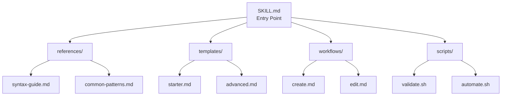
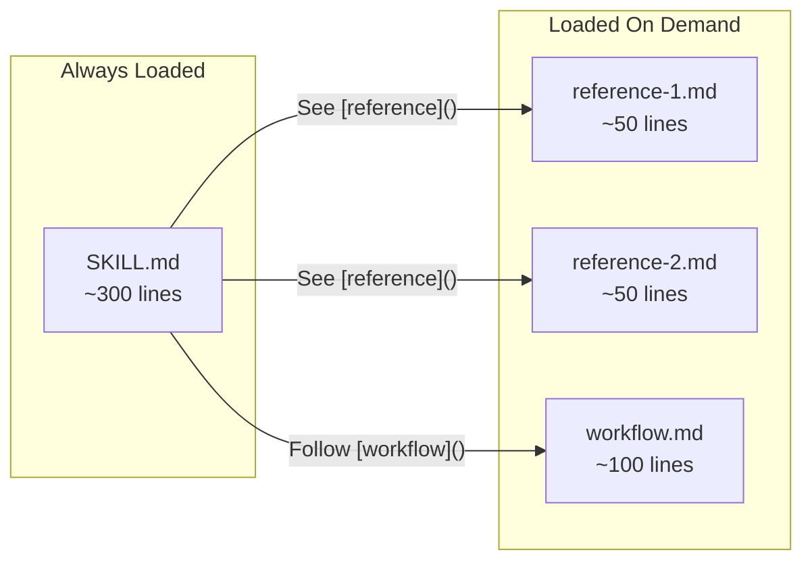

# Skill Architecture

Quick reference for skill structure. For detailed guidance, use: `/create-skill`

## Authored Sources and Generated Output

Author skills under `src/plugins/<plugin>/skills/<skill>/`. The required `SKILL.md.j2` entry point declares `targets:` and renders to `SKILL.md` in each selected harness's generated tree. Edit sources, not `dist/`; [build.py](../tools/buildkit/src/buildkit/build.py) renders the output using the [Claude](../src/harnesses/claude.yaml), [Copilot](../src/harnesses/copilot.yaml), and [Codex](../src/harnesses/codex.yaml) configurations.

Supporting files with a `.j2` suffix are rendered per harness and lose that suffix in output. If a supporting template renders to empty or whitespace-only content, the build omits it **before creating its output parent directory**. This rule does not skip non-template files (copied verbatim, with their mode preserved) or the required `SKILL.md.j2` entry point.

For example, the researching, planning, and two verification-authoring `agents/openai.yaml.j2` templates render only for Codex. Their generated `agents/openai.yaml` metadata and its parent directory are absent from the Claude and Copilot skill output.

Targets are per skill, not per plugin. The authoring-tools plugin ships `creating-agents` and `creating-skills` only on Claude, while `create-verification-skill` and `maintain-verification-skill` target all three harnesses. The plugin therefore appears in every harness registry with different skill membership.

## Directory Structure



## Progressive Disclosure Pattern



## Quick Reference

| Component | Purpose | Line Limit |
|-----------|---------|------------|
| SKILL.md | Entry point with quick start | ~500 |
| references/ | Syntax guides, patterns | ~50 each |
| templates/ | Copy-paste starters | varies |
| workflows/ | Step-by-step guides | ~100 each |
| scripts/ | Automation (executed, not loaded) | ~200 each |

## Naming Conventions

| Type | Pattern | Examples |
|------|---------|----------|
| Skill name | `creating-*`, `managing-*` | `creating-agents`, `git-commits` |
| References | `*-syntax.md`, `*-patterns.md` | `common-patterns.md` |
| Workflows | `create-*.md`, `edit-*.md` | `create-new.md` |
| Scripts | `validate-*.sh` | `validate-diagram.sh` |

## Explicit Invocation Configuration

The selected skills below require explicit user invocation, not automatic model selection. User commands remain enabled by configuration; disabling model invocation is not intended to disable user invocation.

| Skills | Targets | Automatic-invocation control |
|--------|---------|------------------------------|
| `creating-agents`, `creating-skills` | Claude only (`targets: [claude]`) | `disable-model-invocation: true` in rendered skill frontmatter |
| `researching`, `planning` | Claude, Copilot (shared VS Code/CLI output), Codex | Claude/Copilot frontmatter flag; Codex skill-local policy |
| `create-verification-skill`, `maintain-verification-skill` | Claude, Copilot (shared VS Code/CLI output), Codex | Claude/Copilot frontmatter flag; Codex skill-local policy |

Sources: [creating-agents](../src/plugins/authoring-tools/skills/creating-agents/SKILL.md.j2), [creating-skills](../src/plugins/authoring-tools/skills/creating-skills/SKILL.md.j2), [researching](../src/plugins/engineering-workflow/skills/researching/SKILL.md.j2), and [planning](../src/plugins/engineering-workflow/skills/planning/SKILL.md.j2).

Verification workflow sources: [create-verification-skill](../src/plugins/authoring-tools/skills/create-verification-skill/SKILL.md.j2) and [maintain-verification-skill](../src/plugins/authoring-tools/skills/maintain-verification-skill/SKILL.md.j2).

For shared templates, emit the frontmatter flag only for Claude and Copilot:

```jinja

disable-model-invocation: true

```

Both harness configurations allow this skill field. Codex does not; its equivalent control is in the skill-local `agents/openai.yaml`, authored as a supporting template:

```jinja

policy:
  allow_implicit_invocation: false

```

See the [researching metadata template](../src/plugins/engineering-workflow/skills/researching/agents/openai.yaml.j2) and [planning metadata template](../src/plugins/engineering-workflow/skills/planning/agents/openai.yaml.j2). This metadata configures skill invocation; it is not a standalone plugin agent.

Explicit commands are `/authoring-tools:creating-agents` and `/authoring-tools:creating-skills` on Claude. For researching/planning, use `/engineering-workflow:researching` or `/engineering-workflow:planning` on Claude, `/researching` or `/planning` on Copilot, and `$researching` or `$planning` on Codex. Researching shows the planning command at handoff and stops rather than invoking planning automatically.

For the verification workflows installed as plugins, use `/authoring-tools:create-verification-skill` or `/authoring-tools:maintain-verification-skill` on Claude/Copilot VS Code, and `$create-verification-skill` or `$maintain-verification-skill` on Codex. These authoring workflows require explicit invocation, but the project-local verification skills they generate remain eligible for automatic discovery unless the user requests otherwise.

The creator writes to the active harness's `.claude/skills/`, `.github/skills/`, or `.agents/skills/` directory. Maintenance searches all three locations and updates the selected skill in place. The [authoring-tools guide](../src/plugins/authoring-tools/README.md) describes proof requirements, edit scope, and PR prerequisites.

**Copilot CLI caveat:** The shared Copilot output retains the flag, prioritizing automatic-invocation enforcement over known CLI manual-invocation issues. [github/copilot-cli#4438](https://github.com/github/copilot-cli/issues/4438) reports explicit requests failing with `Skill not found`; [github/copilot-cli#4637](https://github.com/github/copilot-cli/issues/4637) reports slash-command instructions loading while a separate lookup emits that error. These reports describe different runtime paths: the configuration expresses manual-only intent, but does not guarantee successful explicit invocation in every CLI version.

## See Also

- [Agent Architecture](agent-architecture.md)
- [Release Workflow](release-workflow.md)
- [Official Skills Docs](https://code.claude.com/docs/en/skills)
